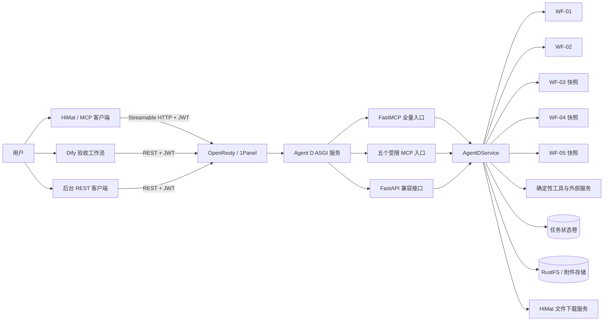
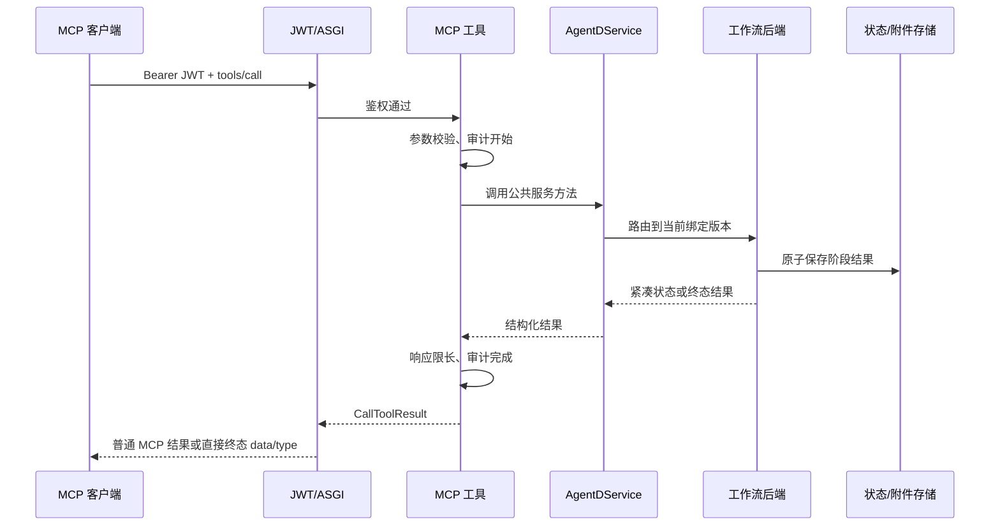

# OligoSmith Agent D 项目工程文档

> 文档定位：面向项目开发、联调、测试、部署和运维的工程交接手册
> 文档版本：`0.1`（首版）
> 对应代码版本：`1.2.13`，并包含 `CHANGELOG.md` 中“未发布”的当前工作区变更
> 整理日期：2026-08-30（Asia/Shanghai）
> 适用分支：`main` 当前稳定开发线
> 项目目录：`agentd-primer-probe/`

本文只从代码、架构、工作流、接口、数据、测试和部署角度说明项目。业务领域只保留识别各工作流所必需的最小背景，不展开领域原理、实验参数或判断依据。

---

## 1. 先看结论

OligoSmith Agent D 是一个以 Python 为主的确定性工作流服务。它把五条公开工作流统一暴露为 MCP、REST API 和 CLI，同时将状态、报告、附件、审计及外部工具调用收口在服务端。

当前工程的核心结论如下：

1. **唯一活动项目**是仓库根目录下的 `agentd-primer-probe/`。外层 `_archive/` 是历史归档，不参与构建和运行。
2. **公开运行范围为 WF-01～WF-05**。WF-06、WF-07 已从活动运行时退役，不应重新接入路由或能力清单。
3. **模型只负责意图识别与工具路由**。工作流推进、状态判断、结果组装和终态卡片全部由后端确定性代码完成。
4. **MCP、REST、CLI 共用 `AgentDService`**，不存在三套互相漂移的业务实现。
5. **工作流采用版本隔离策略**。WF-02 的依赖执行、WF-03、WF-04、WF-05 绑定独立运行快照和状态目录，避免修改一个工作流时影响另一个已发布工作流。
6. **Schema 是机器契约**。输入、交互、过程状态、规范报告和终态输出均由 `schemas/*.schema.json` 约束。
7. **任务状态主要落在文件系统持久化卷**。服务通过临时文件加原子替换提交状态；重试和重设计通常创建新任务，不覆盖父任务。
8. **生产入口是一个 ASGI 进程**：Uvicorn 同时承载 FastMCP、五个受限 MCP 子入口、FastAPI 兼容接口、报告下载和健康检查。
9. **生产部署使用 Docker Compose**。容器只读根文件系统、非 root 用户运行，配置与外部资源只读挂载，任务状态写入独立命名卷。
10. **2026-08-30 的公网只读检查通过**：`/health` 与 `/ready` 均为 `200`，核心工具无缺失，未带 JWT 的 MCP 和 REST 请求均为 `401`。但线上 `databases_required=false`，只能说明服务按当前宽松门禁就绪，不代表所有可选资源都已准备完毕。

---

## 2. 文档读者与阅读顺序

| 角色 | 建议先读 |
|---|---|
| 新加入的后端同事 | 第 4～13 节，再看第 20、24 节 |
| 平台/MCP 联调同事 | 第 7、8、14、18 节 |
| 测试同事 | 第 11、13、20、25 节 |
| 部署与运维同事 | 第 16～19、21～23 节 |
| 负责人/架构评审 | 第 3～6、10～12、26 节 |

本文提供全局地图。涉及某条工作流的字段和细节时，应继续阅读对应现行文档和 JSON Schema，不应仅凭本文修改协议。

---

## 3. 项目范围与稳定边界

### 3.1 项目负责什么

项目负责以下工程能力：

- 接收直接文本输入或 HiMat 上传文件引用；
- 归一化输入并创建可追踪任务；
- 按固定状态机推进 WF-01～WF-05；
- 调用项目内的确定性工具适配层和外部服务；
- 保存任务状态、执行证据、错误、报告和附件；
- 通过 MCP、REST 和 CLI 暴露同一套服务能力；
- 为 HiMat 生成结构严格的交互对象和终态结果卡片；
- 通过 JWT、工具作用域、结果限长、审计脱敏等机制保护服务边界；
- 支持容器部署、健康检查、升级、回滚及离线镜像交付。

### 3.2 项目不负责什么

- 不直接读取 HiMat 的业务数据库；
- 不允许模型读取上传文件正文或服务器本地路径；
- 不在 Dify DSL、MCP 提示词或前端复制后端算法；
- 不把模型生成文本作为权威工作流状态；
- 不把一个工作流的内部状态对象直接交给另一个工作流重新解释；
- 不在当前公开运行时提供 WF-06、WF-07；
- 不把开发降级结果包装成完整执行结果；
- 不以 `/health` 代替完整的部署验收。

### 3.3 当前公开能力

| 工作流 | 工程定位 | 运行模式 | 当前状态 |
|---|---|---|---|
| WF-01 | 单任务设计流水线 | 批次状态机，M1～M7 | 已实现、当前主线 |
| WF-02 | 多目标组合流水线 | N01～N32，持久化后台执行 | 已实现、当前主线 |
| WF-03 | 内标子系统 | 同步确定性后端 + 不可变重试 | 已实现、绑定快照 |
| WF-04 | 已有方案验证 | 六步确定性后端 + 不可变重试 | 已实现、当前有未发布顺序修复 |
| WF-05 | 变化容忍评估 | 六步独立运行包 + 不可变重试 | 已实现、绑定快照 |
| WF-06 | 历史兼容能力 | 无公开运行入口 | 已退役 |
| WF-07 | 历史兼容能力 | 无公开运行入口 | 已退役 |

---

## 4. 架构原则

### 4.1 后端是唯一事实来源

所有状态迁移、执行结果、报告内容和终态卡片都由后端生成。模型只能：

- 判断用户要进入哪条工作流；
- 收集缺失的入口字段；
- 调用对应 MCP 工具；
- 在后端要求等待时结束当前轮次。

模型不得重新计算、补写状态、拼装终态 JSON，或根据自然语言猜测工作流是否完成。

### 4.2 接口层薄、服务层统一

`src/agentd/mcp_server.py`、`src/agentd/api.py` 和 `src/agentd/cli.py` 都委托 `AgentDService`。接口层负责协议适配、鉴权上下文、参数映射、响应限长和异常转换，不持有工作流算法。

### 4.3 工作流隔离优先于代码复用

项目允许共享稳定基础设施，但不允许共享会改变步骤、筛选、排序、重试或报告内容的可变实现。已发布工作流通过 `src/agentd_workflow_snapshots/` 冻结运行依赖。

### 4.4 契约优先

字段结构以 JSON Schema 为准；人类文档解释意图，测试验证实现，代码执行规则。一次协议变更至少要同步：

1. 实现；
2. Schema；
3. 测试；
4. 对应现行文档；
5. `CHANGELOG.md`。

### 4.5 状态与结果分离

“软件是否完整执行”与“最终结果是什么”是两个概念。WF-04、WF-05 明确保存 `execution_status` 和 `decision`；其他工作流也区分流程完成、结果可交付和证据完整性。调用方不得只看一个 `COMPLETED` 字段就推断所有下游条件均满足。

### 4.6 失败必须可追踪且不能伪装成功

工具不可用、外部服务超时、资源缺失、证据不完整或开发降级都必须进入明确状态、错误码、警告或重试信息。后端不允许把“未执行”提升为“通过”。

### 4.7 大数据留在服务端

上传正文、完整候选池、完整规范报告和原始执行产物不进入模型上下文。模型只看到：

- 不透明 `input_artifact_id`；
- 紧凑任务视图；
- 分页摘要；
- 报告或附件地址。

---

## 5. 系统上下文



部署时所有 HTTP 路径都进入同一个应用进程。不要为每个工作流单独启动服务，也不要让 REST 和 MCP 指向不同代码版本。

---

## 6. 分层架构

| 层次 | 主要文件 | 责任 | 禁止事项 |
|---|---|---|---|
| 协议与入口层 | `mcp_server.py`、`mcp_scopes.py`、`api.py`、`cli.py` | MCP/REST/CLI、参数映射、结果适配、路由 | 不实现工作流步骤或算法 |
| 安全与兼容层 | `auth.py`、`mcp_himat_compat.py`、`attachment_urls.py` | JWT、公开路径、签名附件、HiMat 终态兼容 | 不修改权威业务对象含义 |
| 服务编排层 | `service.py` | 初始化依赖、选择运行版本、跨层委托、持久化入口 | 不复制工作流内部规则 |
| 工作流层 | `wf01_v02*.py`、`wf02_v01.py`、`workflows/wf03.py`、`workflows/wf04_v01.py`、快照包 | 状态机、步骤推进、结果组装、重试/版本 | 不绕过公共契约访问其他工作流内部数据 |
| 工具与适配层 | `primer3_tool.py`、`specificity.py`、`alignment.py`、`internal_control.py`、`multiplex.py`、`structure.py` 等 | 封装确定性计算和外部工具调用 | 不感知 MCP/前端轮次 |
| 数据与契约层 | `models.py`、`schema.py`、`schemas/`、`database.py` | 模型、Schema、资源目录与版本解析 | 不硬编码服务器私有路径到工作流 |
| 持久化与交付层 | `job_store.py`、`workflow_isolation.py`、`workflow_delivery.py`、报告渲染器、`object_storage.py` | 状态、报告、附件、对象存储、原子提交 | 不重新计算工作流结论 |
| 运维与发布层 | `deploy/`、`scripts/` | 容器、安装、验证、资源登记、打包 | 不在脚本中复制应用判断逻辑 |

---

## 7. 仓库结构

```text
agentd-primer-probe/
├── config/                         # 默认配置、物种/别名、资源目录示例
├── deploy/                         # Docker、Compose、安装、验证、Dify、服务器配置
├── docs/                           # 现行工程文档、工作流文档、变更记录
├── schemas/                        # JSON Schema 机器契约
├── scripts/                        # 定向验证辅助脚本
├── skills/                         # P1～P6 与 WF-01～WF-05 的 Skill 描述
├── src/
│   ├── agentd/                     # 当前活动服务代码
│   └── agentd_workflow_snapshots/  # 已发布工作流的冻结运行包
├── testdata/                       # 小型、可版本化测试输入
├── tests/                          # 单元、契约、集成、隔离、部署测试
├── pyproject.toml                  # 包、依赖、CLI 和 pytest 配置
└── README.md                       # 项目首页与快速入口
```

### 7.1 必须区分的四类内容

| 类别 | 位置 | 是否参与当前运行 | 修改规则 |
|---|---|---:|---|
| 活动代码 | `src/agentd/` | 是 | 正常开发，但需遵守工作流边界 |
| 冻结快照 | `src/agentd_workflow_snapshots/` | 是 | 默认不可直接改；升级应创建新版本 |
| 历史归档 | 外层 `_archive/` | 否 | 只读参考，不纳入活动项目提交 |
| 运行/构建产物 | `runtime/`、`output/`、`tmp/`、`dist/` 等 | 否 | 已由 `.gitignore` 排除 |

### 7.2 当前代码热点

以下文件体积大、影响面广，修改前应先建立定向测试：

| 文件 | 约行数 | 风险说明 |
|---|---:|---|
| `wf02_v01.py` | 8,500+ | WF-02 全状态机、组合推进、报告固化集中于一处 |
| `wf01_v02_m6.py` | 5,800+ | WF-01 规范报告与多格式交付 |
| `wf01_v02.py` | 4,200+ | WF-01 批次、持久化和阶段调度 |
| `workflow_report_html.py` | 2,700+ | 多工作流 HTML 阅读版渲染 |
| `mcp_server.py` | 2,700+ | 所有 MCP 工具与终态兼容边界 |
| `service.py` | 2,300+ | 依赖装配、版本路由和公共服务门面 |

这些文件目前稳定但已接近“模块拆分阈值”。后续重构应先保持接口和快照不变，再做内部拆分，不能把重构与规则变化混在一个提交中。

---

## 8. 启动与应用装配

### 8.1 入口文件

- Python 包版本：`src/agentd/__init__.py`
- CLI：`src/agentd/cli.py`
- REST 应用：`src/agentd/api.py`
- 生产 ASGI 应用：`src/agentd/mcp_server.py` 中的 `app`
- 容器启动：`uvicorn agentd.mcp_server:app`

生产环境必须启动 `agentd.mcp_server:app`，不能只启动 `agentd.api:app`。后者缺少完整 MCP、统一 JWT 外壳和 HiMat 终态兼容中间件。

### 8.2 启动顺序

应用导入时按以下顺序装配：

1. 读取 `config/defaults.json`；
2. 按需深度合并 `AGENTD_CONFIG` 指向的覆盖配置；
3. 初始化 `DatabaseCatalog`、任务目录、审计和输入 artifact 存储；
4. 初始化 WF-01 当前服务；
5. 初始化 WF-02 的 WF-01 依赖快照、WF-02 状态机、缓存与后台执行器；
6. 初始化 WF-03～WF-05 的独立状态目录、快照运行包和报告交付器；
7. 恢复 WF-02 中持久化为 `QUEUED` 或 `RUNNING` 的后台任务；
8. 注册全量 MCP 工具和资源；
9. 根据白名单构建五个受限 MCP Server；
10. 挂载 FastAPI 兼容应用；
11. 套用 HiMat 终态结果兼容中间件；
12. 最外层套用 JWT Bearer 中间件。

### 8.3 中间件和路径顺序

从外到内可以理解为：

```text
JWTBearerMiddleware
  -> HiMatDirectResultCompatibilityMiddleware
    -> FastMCP /mcp
    -> Scoped FastMCP /mcp/wf01/ ... /mcp/wf05/
    -> FastAPI /
```

顺序很重要：鉴权必须覆盖 MCP 与 REST；终态兼容只改写 MCP 终态响应，不应影响普通 REST JSON。

---

## 9. 请求链路

### 9.1 普通 MCP 请求



### 9.2 上传文件请求

上传场景固定使用“下载—引用—运行”两段式链路：

1. 客户端调用 `download_himat_file(file_id)`；
2. Agent D 后端从配置的 HiMat 下载地址获取文件；
3. 服务校验大小、保存元数据与内容，生成不透明 `input_artifact_id`；
4. 模型只把 `input_artifact_id` 传给后续工作流工具；
5. 工作流后端在服务器内部解析文件；
6. 对外结果只保留 ID、文件名、大小、哈希和安全标签，不泄露内部路径。

不得把文件正文先交给模型解析，也不得让模型构造本地路径。

### 9.3 终态结果

五条工作流统一使用 `primer_design_output` 终态结构。内部 FastMCP 仍生成标准 `CallToolResult`，但 `HiMatDirectResultCompatibilityMiddleware` 会在 HTTP 边界识别终态并将权威 `structuredContent` 提升为 JSON-RPC `result`。

终态 `result` 顶层严格只包含：

- `data`
- `type`

模型不得在终态之后继续回复文本、解释结果或再次调用工具。任何额外包装都可能导致 HiMat 卡片无法渲染。

### 9.4 REST 与 Dify

FastAPI 路由调用同一个 `AgentDService`。`deploy/dify/oligosmith-agentd-workflow.yml` 是确定性流程验收台，不包含 LLM，也不是第二套工作流实现。

---

## 10. `AgentDService` 的职责

`AgentDService` 是系统门面和依赖装配中心。它负责：

- 加载配置和资源目录；
- 选择状态根目录；
- 初始化当前工作流及其固定版本依赖；
- 将上传 artifact 解析为后端内部输入；
- 在 MCP、REST、CLI 之间提供统一方法；
- 把工作流结果写入对应状态域；
- 将工作流异常翻译为公共错误；
- 提供能力清单、工具状态和 readiness；
- 路由报告与附件下载；
- 触发 WF-02 后台恢复。

它不应负责：

- 在多个工作流之间复制判断逻辑；
- 重新解释快照工作流返回的状态；
- 在接口层计算结果；
- 用共享工具代码静默改变已冻结工作流行为。

### 10.1 当前运行绑定

| 工作流 | 运行绑定 | 权威状态目录 |
|---|---|---|
| WF-01 | 当前 `WF01V02BatchService` | 状态根目录下 WF-01 专属目录 |
| WF-02 | `WF02V01BatchService` | `wf02-v01-*` 目录 |
| WF-02 的 WF-01 子任务 | `wf02_wf01_v1` 快照 | `workflow-snapshots/wf02-wf01-execution-snapshot-v1` |
| WF-03 | `wf03_v1` 快照 | `workflow-snapshots/wf03-runtime-snapshot-v1` |
| WF-04 | `wf04_v1` 快照 | `workflow-snapshots/wf04-runtime-snapshot-v1` |
| WF-05 | `wf05_v1` 快照 | `workflow-snapshots/wf05-runtime-snapshot-v1` |

根状态目录中可能存在兼容副本，但版本目录中的结果才是权威数据。

---

## 11. 工作流设计

### 11.1 通用生命周期

虽然五条工作流内部状态不同，但工程生命周期基本一致：

```text
输入校验
  -> 建立任务/草稿
  -> 持久化不可变入口快照
  -> 按节点推进
  -> 遇到用户输入或后台边界时暂停
  -> 从持久化状态恢复
  -> 生成规范报告
  -> 渲染终态附件
  -> 发布或签发下载地址
  -> 返回统一终态卡片
```

### 11.2 WF-01：M1～M7 批次状态机

| 阶段 | 工程责任 | 主要实现 |
|---|---|---|
| M1 | 输入预检、任务建立、模式选择、入口快照 | `wf01_v02.py` |
| M2 | 运行前置处理、调用设计工具、收集执行证据 | `wf01_v02_engine.py` |
| M3 | 候选去重、初步评分、搜索清单校验 | `wf01_v02_m3.py` |
| M4 | 解析外部资源、调用特异性服务、映射与重排 | `wf01_v02_m4.py` |
| M5 | 汇总任务状态、缺口、可交付集合 | `wf01_v02_m5.py` |
| M6 | 组装规范报告、渲染并发布附件 | `wf01_v02_m6.py` |
| M7 | 生成不可变新版本和字段差异 | `wf01_v02_m7.py` |

正常新任务在建批后由 `run_wf01_until_blocked` 自动推进，不要求模型逐阶段串联。逐阶段 REST 入口主要用于测试、故障恢复和后台控制。

WF-01 的重要工程边界：

- M2 启动后不得原地修改入口；变化通过 M7 新版本表达；
- 完整批次与报告可达数 MB，MCP 只返回 `wf01-agent-view-v1` 紧凑视图；
- 阶段处于 `RUNNING` 或存在待处理交互时禁止非幂等重入；
- M6 生成报告不等于所有外部依赖均完整执行；
- 当前新建入口要求走完整生产路线，兼容代码仍可读取历史降级批次。

### 11.3 WF-02：N01～N32 后台状态机

WF-02 是当前最复杂的工作流，按六个工程阶段组织：

| 阶段 | 节点 | 工程责任 |
|---|---|---|
| 阶段 1 | N01～N05 | 输入识别、文件映射、草稿交互、冻结建单快照 |
| 阶段 2 | N06～N09 | 为每个目标运行隔离的 WF-01 子任务并收集公开候选契约 |
| 阶段 3 | N10～N14 | 按条件调用公共子系统并准备额外通道信息 |
| 阶段 4 | N15～N20 | 分批枚举组合、调用公共兼容性服务、保存游标 |
| 阶段 5 | N21～N26 | 运行版本化放宽策略、部分方案和失败出口 |
| 阶段 6 | N27～N32 | 均衡、评分、去重、Top 结果、报告和终态交付 |

WF-02 的运行特征：

- `WF02BackgroundExecutor` 使用后台 worker 接管持久化任务；
- 首次运行请求最多同步等待 235 秒；
- 超时后返回 `WAIT_FOR_BACKGROUND`，前台连接结束，后台继续；
- 服务重启后恢复 `QUEUED`/`RUNNING` 任务；
- 状态以原子快照提交，前台超时读取最近快照，不等待长执行锁；
- 创建请求按认证调用方和请求摘要做近期去重，降低传输失败导致的重复任务；
- 组合计算通过持久化游标分批推进；
- `WF02P4PairCache` 使用 SQLite 保存版本化成对计算缓存；
- 每个上传文件只绑定一个目标，文件正文仍由后端处理；
- WF-02 只消费 `wf01-candidate-contract-v1`，不读取 WF-01 内部私有状态。

### 11.4 WF-03：薄编排工作流

WF-03 采用“模型路由 → MCP 薄入口 → 服务层 → 固定后端 → 公共工具”的结构。工作流自身只做输入规范化、调用一次公共子系统、映射状态和生成报告，不复制底层工具实现。

失败后使用 `retry_wf03_internal_control`：

- 从父任务恢复私有输入；
- 只接受白名单补丁；
- 创建新 `job_id`；
- 在 provenance 中记录父子关系；
- 不覆盖父结果。

### 11.5 WF-04：六步验证工作流

当前执行顺序固定为：

```text
Step 1 入口与本地校验
  -> Step 2 外部检查 A
  -> Step 3 外部检查 B
  -> Step 4 外部检查 C
  -> Step 5 可选工具与兼容性汇总
  -> Step 6 确定性结果与持久化
```

`CHANGELOG.md` 的“未发布”项正在把真实执行顺序与审计轨迹完全对齐。WF-04 同时保存：

- `execution_status`：步骤和必需依赖是否完整执行；
- `decision`：最终结果；
- `retryable_steps`：允许重试的步骤；
- `workflow_trace`：逐步状态、耗时、工具和错误码。

重试会创建不可变子任务，并可复用未受影响的成功步骤。

### 11.6 WF-05：独立六节点快照

WF-05 绑定最小依赖运行包，六个节点依次处理输入集合、对齐、变化扫描、影响评估、覆盖汇总和最终结果。其关键工程约束是：

- 只调用冻结的既有工具快照；
- 运行前验证关键文件 SHA-256；
- 包内仅使用相对导入；
- 不导入或自动调用其他工作流；
- 重试创建不可变子任务；
- 跨工作流建议仅作为结构化 handoff，不自动执行。

---

## 12. 工作流隔离和版本策略

### 12.1 为什么需要快照

如果所有工作流都直接导入 `src/agentd/` 的最新实现，那么一次公共模块修改可能让历史任务和其他工作流发生行为漂移。当前方案通过版本化运行包冻结依赖，把“代码复用”升级为“显式契约复用”。

### 12.2 不可变规则

1. 已发布 `agentd_workflow_snapshots/<name>_vN` 默认不做功能修改；
2. 行为变化时复制为 `vN+1`；
3. 在 `AgentDService` 中只迁移目标工作流的绑定；
4. 旧任务继续由旧版本目录读取；
5. 新任务写入新状态目录；
6. 快照内部不得绝对导入回顶层可变 `agentd` 包；
7. 快照来源、文件集合和摘要由测试固定。

当前 WF-04 处于明确登记的受限开发修订期，允许同步修改它自己的开发源和独立运行包，但修改范围由完整性测试限制，不能扩散到其他快照。

### 12.3 公共共享边界

允许共享：

- API/MCP 路由；
- JWT 和输入文件下载；
- 公共异常；
- 对象存储发布接口；
- 版本选择与旧任务查找。

必须留在工作流版本包内：

- 步骤顺序；
- 筛选和排序；
- 状态映射；
- 重试策略；
- 报告内容和终态解释。

---

## 13. 数据契约与状态模型

### 13.1 Schema 分类

| 类别 | 代表文件 | 用途 |
|---|---|---|
| 公共输出 | `agentd-output.schema.json` | 通用工作流输出外壳 |
| 前端交互 | `agent-interaction*.schema.json` | 等待用户时的结构化交互与回复 |
| 终态卡片 | `primer-design-output.schema.json` | HiMat 最终卡片 |
| WF-01 | `wf01-v02-canonical-report.schema.json` 等 | 批次报告和执行产物 |
| WF-02 | `wf02-v01-*.schema.json` | 草稿、批次、报告 |
| WF-03～05 | `wf03/04/05-v01-*.schema.json` | 输入、重试、报告 |

### 13.2 三种常见对象

1. **控制视图**：给模型或前端查看下一步，必须紧凑、可分页；
2. **权威任务对象/规范报告**：服务端持久化的完整事实，可较大；
3. **终态卡片**：只提供用户可见附件和必要摘要，结构严格固定。

三者不能互相替代。尤其不能用控制视图重建完整报告，也不能把完整报告直接塞进 MCP 普通响应。

### 13.3 标识符

- 内部任务通常使用 UUID；
- WF-01 等会额外生成适合展示的任务编号；
- 重试/新版本通过 `parent_job_id` 或版本谱系关联；
- 附件使用任务 ID、格式和文件名定位；
- 上传文件使用独立 `input_artifact_id`，不暴露磁盘路径。

### 13.4 状态读取原则

- 先看工作流自身状态，不要跨工作流套用枚举；
- 同时看 `next_action`/`flowControl`；
- WF-04、WF-05 必须同时看 `execution_status` 与 `decision`；
- 终态附件已生成只表示交付闭环完成，不自动证明所有可选依赖都执行；
- 需要用户输入时必须等待新的用户轮次，不能在同一轮伪造回复。

---

## 14. 持久化、缓存与附件

### 14.1 状态根目录

本地默认状态目录为 `runtime/jobs`；生产通过 `AGENTD_STATE_DIR=/data/jobs` 指向 Docker 命名卷 `agentd-jobs`。

概念布局如下：

```text
/data/jobs/
├── wf01-*                               # WF-01 批次、报告、执行证据
├── wf02-v01-drafts/                     # WF-02 草稿
├── wf02-v01-batches/                    # WF-02 批次快照
├── wf02-v01-reports/                    # WF-02 规范报告
├── wf02-v01-exports/                    # WF-02 附件
├── wf02-v01-p4-cache/                   # WF-02 SQLite 计算缓存
├── input-artifacts/                     # HiMat 上传文件内部存储
├── audit/                               # 脱敏工具审计
└── workflow-snapshots/
    ├── wf02-wf01-execution-snapshot-v1/
    ├── wf03-runtime-snapshot-v1/
    ├── wf04-runtime-snapshot-v1/
    └── wf05-runtime-snapshot-v1/
```

实际子目录名称以代码为准；排障时先通过服务方法定位，不要依赖手工猜路径。

### 14.2 原子写入

任务 JSON、报告和附件元数据普遍采用：

1. 写入同目录临时文件；
2. 完整写入后执行原子替换；
3. 读取方只读取正式文件。

这样可降低进程异常、并发请求或前台超时造成半文件的概率。

### 14.3 不可变重试和版本

WF-01 M7、WF-02 新版本、WF-03～WF-05 重试都优先创建新任务，并保存父任务、差异和重试原因。父任务不应被覆盖，这保证报告和执行证据可审计、可回滚。

### 14.4 附件发布

附件有两种交付方式：

- **RustFS 已启用**：后端上传对象并通过 `HEAD Object` 校验大小和 SHA-256 元数据，成功后保存完整公网 URL；
- **RustFS 未启用**：WF-02 可使用有时效、绑定路径和格式的签名只读 URL；WF-01 是否匿名只读取决于部署变量。

HTML 是默认用户交付格式；其他格式一般按需生成。规范报告与附件渲染分离，重新生成展示附件不应重新执行工作流。

---

## 15. 主要代码模块

| 模块 | 责任 | 修改注意事项 |
|---|---|---|
| `api.py` | FastAPI 路由、HTTP 状态转换、文件响应 | 与 MCP 共用服务，不创建旁路实现 |
| `mcp_server.py` | 工具注册、审计包装、限长、终态输出 | 改工具名会影响 Skill、作用域和部署验收 |
| `mcp_scopes.py` | 五个受限工具白名单与本地化 | 白名单必须与测试和文档一致 |
| `mcp_himat_compat.py` | 终态 JSON-RPC 直接投影 | 只处理终态，不污染普通结果 |
| `auth.py` | JWT、公开探针、公开/签名附件 | 公开路径变化属于安全变更 |
| `service.py` | 依赖装配、版本路由、公共服务 | 避免继续扩大工作流内逻辑 |
| `config.py` | 默认配置与覆盖配置深度合并 | 配置变化要进入 provenance 指纹 |
| `database.py` | 逻辑资源键、版本、别名和可用性 | 路径属于部署配置，不应写入工作流 |
| `input_artifacts.py` | 下载、大小限制、哈希、不透明引用 | 不向模型返回正文和本地路径 |
| `audit.py` | 工具开始/完成/失败和脱敏输出 | 审计失败不能中断主流程 |
| `wf01_v02*.py` | WF-01 批次及 M2～M7 | 与 WF-01 Schema/现行文档同步 |
| `wf02_v01.py` | WF-02 N01～N32 | 修改前优先增加定向状态机测试 |
| `wf02_runtime.py` | 后台 worker、恢复和缓存 | 保持原子快照与超时边界 |
| `workflows/wf03.py` | WF-03 薄编排 | 不复制公共工具算法 |
| `workflows/wf04_v01.py` | WF-04 六步后端 | 保持执行状态与结果分离 |
| `workflow_isolation.py` | 作用域状态和交付路由 | 版本目录是权威来源 |
| `workflow_delivery.py` | 终态 HTML、元数据、发布 | 渲染必须幂等并校验路径 |
| `object_storage.py` | RustFS/S3 发布和完整性校验 | 凭据只能来自环境变量 |
| `*_report*.py` | HTML/PDF/CSV 阅读版 | 不在渲染层改变结论 |

---

## 16. 配置体系

### 16.1 配置优先级

应用配置按以下顺序合并，后者覆盖前者：

1. `config/defaults.json`；
2. `AGENTD_CONFIG` 或 CLI `--config` 指向的 JSON；
3. 代码调用时显式传入的 `config_overrides`。

部署相关的端口、鉴权、外部服务和对象存储主要通过环境变量注入。

### 16.2 关键配置文件

| 文件 | 用途 | 是否可提交真实凭据 |
|---|---|---:|
| `config/defaults.json` | 开发默认值和基础规则 | 否 |
| `config/database-catalog.example.json` | 资源目录示例 | 否 |
| `deploy/server-config/production.json` | 生产 Profile 和工具命令 | 是，但不能含密钥 |
| `deploy/server-config/database-catalog.json` | 容器内逻辑资源路径 | 是，但应使用部署路径和真实版本 |
| `deploy/.env.example` | 环境变量模板 | 是，只能放占位值 |
| `deploy/.env` | 当前服务器密钥和路径 | **禁止提交** |

### 16.3 环境变量分组

| 分组 | 代表变量 | 说明 |
|---|---|---|
| 服务 | `AGENTD_IMAGE_TAG`、`AGENTD_BIND_ADDRESS`、`AGENTD_PORT` | 镜像与端口 |
| 资源 | `AGENTD_BLASTDB_DIR`、`AGENTD_SEQUENCE_DATA_DIR` | 宿主机只读挂载目录 |
| 就绪门禁 | `AGENTD_REQUIRE_DATABASES` | 是否把必需资源纳入 readiness 硬门禁 |
| 状态 | `AGENTD_STATE_DIR` | 任务持久化目录 |
| MCP | `MCP_PUBLIC_BASE_URL`、`MCP_MAX_TOOL_RESULT_BYTES` | 公网地址与响应上限 |
| WF-02 | `MCP_WF02_SYNC_WAIT_SECONDS`、`WF02_BACKGROUND_WORKERS` | 前台等待和后台并发 |
| JWT | `JWT_SECRET`、`MCP_JWT_ALGORITHM`、`MCP_JWT_REQUIRE_EXP` | 鉴权配置 |
| HiMat | `HIMAT_FILE_DOWNLOAD_BASE_URL`、超时和大小上限 | 上传文件下载 |
| 外部服务 | `BLAST_SEARCH_SERVICE_URL` 等 | 外部确定性服务 |
| 对象存储 | `RUSTFS_*` | 附件发布 |

任何新增环境变量都应同步 `.env.example`、Compose、部署文档、验证脚本和测试。

---

## 17. 安全设计

### 17.1 JWT

除 `/health`、`/ready` 和明确配置的只读附件外，HTTP 路径默认要求 Bearer JWT。支持 `HS256`、`HS384`、`HS512`，默认要求 `exp`。

注意：

- `JWT_SECRET` 是签名密钥，不是客户端 Token；
- Token 应通过 `deploy/scripts/generate-jwt.sh` 生成；
- 轮换密钥会使已有 Token 和本地签名附件地址失效；
- 日志和提交中不得出现密钥或真实 Token。

### 17.2 MCP 作用域

生产客户端优先连接 `/mcp/wf01/`～`/mcp/wf05/`。每个入口只注册对应工作流工具，减少模型上下文、误调用和横向能力暴露。全量 `/mcp` 仅保留兼容用途。

### 17.3 网络与主机保护

- FastMCP 开启 DNS rebinding 防护；
- `MCP_ALLOWED_HOSTS` 和 `MCP_ALLOWED_ORIGINS` 限制 Host/Origin；
- Compose 默认只绑定 `127.0.0.1`；
- TLS、限流和外部访问控制交给 OpenResty/1Panel；
- 容器以 UID `10001` 非 root 用户运行；
- 根文件系统只读，`/tmp` 使用限额 tmpfs；
- 外部数据目录只读挂载。

### 17.4 数据最小化

- 上传正文不进入模型上下文；
- 审计对大文本、序列、Token、密码和密钥做摘要或移除；
- 审计记录可观察执行事实，不记录模型内部思维过程；
- 服务不直接读取 HiMat 业务库；
- 完整报告通过后端下载或对象存储交付，而不是进入普通工具响应。

### 17.5 当前需确认的安全项

`MCP_PUBLIC_WF01_ARTIFACTS=true` 会开放部分 WF-01 只读报告和附件。是否符合正式数据分级要求，应由项目负责人和平台安全共同确认；如不需要匿名访问，应设为 `false`。

---

## 18. 对外接口

### 18.1 MCP

| 入口 | 工具数 | 用途 |
|---|---:|---|
| `/mcp` | 29 | 全量兼容入口 |
| `/mcp/wf01/` | 10 | WF-01 + 文件下载 |
| `/mcp/wf02/` | 11 | WF-02 + 文件下载 |
| `/mcp/wf03/` | 4 | WF-03 + 文件下载 |
| `/mcp/wf04/` | 4 | WF-04 + 文件下载 |
| `/mcp/wf05/` | 4 | WF-05 + 文件下载 |

工具白名单由 `mcp_scopes.py` 维护，部署验收会检查每个入口的精确工具集合。

### 18.2 REST 分组

| 分组 | 路径前缀 | 用途 |
|---|---|---|
| 运维 | `/health`、`/ready`、`/v1/tool-status`、`/v1/capabilities` | 存活、就绪、能力 |
| 审计 | `/v1/audit/agent` | 脱敏工具执行事实 |
| WF-01 | `/v1/wf01/...` | 批次、推进、交互、报告、导出 |
| WF-02 | `/v1/wf02/...` | 草稿、后台任务、交互、面板、报告、导出 |
| WF-03 | `/v1/wf03/...` | 运行、重试、报告 |
| WF-04 | `/v1/wf04/...` | 运行、重试、报告 |
| WF-05 | `/v1/wf05/...` | 运行、重试、报告 |
| 兼容层 | `/v1/workflows/{workflow}/run` | 旧调用方统一入口 |
| 附件 | `/data/...` | 报告文件 |

字段级请求体以 OpenAPI 与 `schemas/` 为准。不要从文档示例复制旧请求结构作为正式契约。

### 18.3 CLI

CLI 命令：

- `agentd run --workflow WF-01 ... WF-05`
- `agentd tool-status`
- `agentd capabilities`
- `agentd readiness`
- `agentd serve`

CLI 适合本地验证和非对话式执行。WF-01、WF-02 的完整交互和后台能力仍以专用 MCP/REST 入口为主。

---

## 19. 本地开发

### 19.1 前置条件

- Windows 或 Linux；生产行为优先以 Linux 容器为准；
- Python `>=3.11`；容器使用 Python 3.12；
- 推荐使用 `uv` 管理虚拟环境；
- 完整工具链需要系统级可执行文件和 Python 原生扩展；
- 不要把本地运行状态写入 Git。

### 19.2 创建环境

```powershell
uv venv .venv
uv pip install --python .venv\Scripts\python.exe -e ".[scientific,api,mcp,dev]"
```

### 19.3 基础检查

```powershell
.venv\Scripts\agentd.exe tool-status
.venv\Scripts\agentd.exe capabilities
.venv\Scripts\agentd.exe readiness
```

### 19.4 启动本地服务

JWT 开启时先设置本地密钥，再启动统一 ASGI 应用：

```powershell
$env:MCP_JWT_SECRET = "仅用于本机开发的长随机值"
$env:AGENTD_STATE_DIR = "$PWD\runtime\jobs"
.venv\Scripts\agentd.exe serve --host 127.0.0.1 --port 8000
```

本地联调依旧应访问 `agentd.mcp_server:app`，以覆盖与生产一致的中间件。

### 19.5 开发降级

`--allow-fallback` 只用于验证工程链路。使用后必须保持显式降级状态，不能把结果当作完整生产执行。自动化测试应分别覆盖：

- 依赖可用；
- 依赖不可用；
- 显式开发降级；
- 生产模式禁止降级。

---

## 20. 测试与质量门禁

### 20.1 测试层次

| 层次 | 代表测试 | 目的 |
|---|---|---|
| 单元测试 | `test_sequence.py`、`test_rules.py` 等 | 小函数和工具行为 |
| 工作流测试 | `test_wf01_*`、`test_wf02_*`、`test_wf03_backend.py` 等 | 状态机、重试、报告 |
| 接口测试 | `test_api.py`、`test_mcp_server.py` | REST/MCP 参数与输出 |
| 安全测试 | `test_mcp_scopes.py`、附件/JWT 相关测试 | 白名单、鉴权、公开边界 |
| 契约测试 | `test_schema_contract.py`、工作流 Schema 测试 | JSON Schema 一致性 |
| 隔离测试 | `test_workflow_isolation.py`、`test_workflow_snapshot_integrity.py` | 快照不可变和状态隔离 |
| 交付测试 | `test_workflow_delivery.py`、报告 HTML 测试 | 附件、幂等、转义、完整性 |
| 部署测试 | `test_deployment_package.py`、`test_dify_dsl.py` | Compose、脚本、发布包、Dify |

### 20.2 日常命令

完整测试：

```powershell
.venv\Scripts\python.exe -B -m pytest -q -p no:cacheprovider
```

提交前至少还应执行：

```powershell
git diff --check
.venv\Scripts\python.exe -m agentd capabilities
.venv\Scripts\python.exe -m agentd readiness
```

readiness 在本地可能因外部资源缺失返回非零；这时应记录原因，不能简单忽略输出。

### 20.3 修改后的最低测试策略

| 修改范围 | 最低要求 |
|---|---|
| 单一工具 | 工具单测 + 受影响工作流定向测试 |
| MCP/REST | 接口定向测试 + Schema + 终态兼容测试 |
| WF-01 | 全部 `test_wf01_*` + Schema + MCP |
| WF-02 | `test_wf02_*` + 后台恢复 + 缓存 + MCP |
| WF-03～05 | 对应后端/MCP/交付 + 快照完整性 |
| 快照或隔离 | 完整回归，不接受只跑定向测试 |
| Compose/部署 | 部署包测试 + `deploy/scripts/verify.sh` |

### 20.4 测试数据原则

- 测试数据应小、确定、可版本化；
- 不提交真实用户上传文件；
- 大型外部资源放在部署目录外；
- 网络测试应有明确超时和可解释降级；
- 不用历史运行产物代替 fixture。

---

## 21. Docker 与线上部署

### 21.1 部署拓扑

```text
公网 HTTPS
  -> OpenResty / 1Panel
  -> 127.0.0.1:8020
  -> Docker 端口映射
  -> agentd:8000
  -> Uvicorn + FastMCP + FastAPI
```

### 21.2 容器基线

| 项目 | 当前值 |
|---|---|
| 镜像 | `agentd-primer-probe:1.2.13` |
| 基础镜像 | `python:3.12-slim` |
| 服务 | `agentd` |
| 工作目录 | `/app` |
| 进程用户 | UID `10001`，非 root |
| 容器端口 | `8000` |
| 默认宿主映射 | `127.0.0.1:8020 -> 8000` |
| CPU | 默认 `4.0` |
| 内存 | 默认 `8g` |
| PID 上限 | `256` |
| 根文件系统 | 只读 |
| 临时目录 | `/tmp`，512 MB tmpfs |
| 重启策略 | `unless-stopped` |

### 21.3 卷和挂载

| 容器路径 | 权限 | 用途 |
|---|---|---|
| `/config/production.json` | 只读 | 生产配置 |
| `/config/database-catalog.json` | 只读 | 逻辑资源目录 |
| `/data/blastdb` | 只读 | 外部数据库资源 |
| `/data/sequences` | 只读 | 外部序列资源 |
| `/data/jobs` | 可写命名卷 | 任务、后台恢复、缓存、报告和上传 artifact |

容器不包含大型业务数据。资源应在安装包外版本化管理，通过只读卷挂载。

### 21.4 首次部署

1. 复制 `deploy/.env.example` 为 `deploy/.env`；
2. 设置长随机 `JWT_SECRET`；
3. 设置宿主机数据目录；
4. 核对 `AGENTD_REQUIRE_DATABASES`；
5. 配置对象存储和外部服务；
6. 校验资源目录；
7. 执行安装脚本；
8. 执行部署验收；
9. 配置 OpenResty/1Panel 反向代理；
10. 从公网再次检查健康、鉴权和附件。

推荐命令：

```bash
cp deploy/.env.example deploy/.env
chmod 600 deploy/.env
bash deploy/scripts/install.sh
bash deploy/scripts/verify.sh --wait 180
```

手工 Compose 路线：

```bash
docker compose --env-file deploy/.env -f deploy/docker-compose.yml config --quiet
docker compose --env-file deploy/.env -f deploy/docker-compose.yml build --pull
docker compose --env-file deploy/.env -f deploy/docker-compose.yml up -d
bash deploy/scripts/verify.sh --wait 180
```

### 21.5 反向代理

建议整个域名统一转发到 `http://127.0.0.1:8020`，不要给五个 MCP 入口分别建代理。代理必须保留：

- `Authorization` 请求头；
- Streamable HTTP 所需方法；
- 合理的长请求超时；
- 原始 Host/Forwarded 信息；
- 大附件下载能力。

### 21.6 当前公网检查

2026-08-30 09:36（Asia/Shanghai）对 `https://oligosmith.ne.scqcyz.cn` 进行只读检查：

| 检查项 | 结果 |
|---|---|
| `GET /health` | `200 OK`，服务名正确，Phase 3 |
| `GET /ready` | `200 OK`，`status=ready` |
| `core_ready` | `true` |
| 必需核心工具缺失 | 无 |
| 资源目录 | 已加载，报告 67 个逻辑资源条目 |
| 外部背景服务健康 | 已验证 |
| 未带 JWT 的 `/mcp` | `401`，符合预期 |
| 未带 JWT 的 `/v1/capabilities` | `401`，符合预期 |
| `databases_required` | `false` |

最后一项需要特别注意：当前线上 Profile 名为 `server-production`，但资源硬门禁处于关闭状态。`/ready=200` 只表示“按当前配置可启动”，不表示所有可选资源均可用。正式严格验收前，应确认是否把 `AGENTD_REQUIRE_DATABASES` 改为 `true`，并重新执行完整验证。

---

## 22. 运维

### 22.1 常用命令

```bash
docker compose --env-file deploy/.env -f deploy/docker-compose.yml ps
docker compose --env-file deploy/.env -f deploy/docker-compose.yml logs -f agentd
docker compose --env-file deploy/.env -f deploy/docker-compose.yml restart agentd
docker compose --env-file deploy/.env -f deploy/docker-compose.yml stop
```

### 22.2 `/health` 与 `/ready`

- `/health`：只检查进程和 HTTP 应用是否存活；
- `/ready`：检查核心工具、配置和当前门禁要求的资源；
- `/ready=200`：仍需结合 `databases_required`、`required_missing` 和外部服务字段解释。

### 22.3 日志与审计

- 容器 stdout/stderr：查看启动错误、异常堆栈和 Uvicorn 请求；
- Docker `json-file`：单文件 20 MB，保留 5 个；
- Agent 审计：查看工具开始/完成/失败、字段映射、状态和脱敏输出；
- 任务 trace：查看具体工作流节点、耗时、错误码与重试步骤。

排障时不要只看模型回复；应从任务 ID 反查审计、持久化状态和工作流 trace。

### 22.4 常见故障

| 现象 | 优先检查 | 处理方向 |
|---|---|---|
| `/health` 失败 | 容器状态、启动日志、端口 | 修复进程或代理 |
| `/health` 成功、`/ready` 失败 | 工具状态、资源目录、挂载权限 | 修复配置或资源，不绕过门禁 |
| MCP 401 | Token、过期时间、签名算法、密钥轮换 | 重新签发 Token |
| MCP 工具缺失 | 是否连接正确受限入口、客户端缓存 | 刷新 `tools/list` |
| HiMat 终态卡片不显示 | JSON-RPC `result` 是否严格为 `data/type` | 检查终态兼容层和宿主解析 |
| 上传文件后无法运行 | 下载地址、大小限制、artifact 元数据 | 查询下载审计，不让模型读取正文 |
| WF-02 长时间运行 | 后台 worker、任务快照、当前执行单元 | 单次查询状态，避免轮询风暴 |
| 报告地址不可用 | RustFS 发布、签名过期、代理下载路径 | 重新发布/请求对应导出 |
| 重试覆盖了旧结果 | 父子 ID 和状态目录 | 视为严重契约回归，停止发布 |

### 22.5 禁止操作

不要执行：

```bash
docker compose down -v
```

除非已经确认并备份 `agentd-jobs`。普通 `stop`、`restart` 和不带 `-v` 的 `down` 不会删除任务卷。

---

## 23. 升级、备份与回滚

### 23.1 升级前备份

- `deploy/.env`；
- `deploy/server-config/`；
- 外部资源目录及其版本清单；
- `agentd-jobs` 卷；
- 当前镜像标签和发布包 SHA-256；
- 反向代理配置。

### 23.2 升级流程

1. 合并稳定代码并更新版本；
2. 完整测试；
3. 生成发布包和校验清单；
4. 使用新镜像标签构建；
5. 在最终容器中执行 readiness；
6. 备份任务卷；
7. 切换容器；
8. 执行 `verify.sh`；
9. 公网检查健康、鉴权和附件；
10. 观察日志后结束变更窗口。

### 23.3 回滚

回滚应恢复：

- 旧镜像标签；
- 与旧版本匹配的配置；
- 旧资源目录版本；
- 必要时恢复任务卷备份。

不要原地覆盖外部资源索引。应采用“新建版本目录 → 校验 → 切换目录配置”的方式，使代码和数据都可回滚。

---

## 24. 团队协作与 Git 规范

### 24.1 分支建议

- `main`：可部署稳定线；
- `feature/<scope>-<summary>`：功能；
- `fix/<scope>-<summary>`：缺陷；
- `docs/<summary>`：纯文档；
- `release/<version>`：需要发布窗口时使用。

当前仓库此前有大量本地稳定变更未同步，完成本轮基线提交后，应恢复“小批次、可审查”的提交节奏。

### 24.2 提交边界

一次提交尽量只包含一个可描述目标。建议按以下类型拆分：

- `feat:` 新能力；
- `fix:` 缺陷修复；
- `refactor:` 不改变行为的重构；
- `test:` 测试；
- `docs:` 文档；
- `deploy:` 部署与运维；
- `chore:` 清理和维护。

### 24.3 Pull Request 必填信息

1. 修改目的；
2. 影响工作流；
3. 是否改变 Schema；
4. 是否改变持久化格式；
5. 是否影响旧任务；
6. 是否修改快照；
7. 测试命令和结果；
8. 部署或回滚要求；
9. 文档和变更记录是否同步。

### 24.4 变更联动规则

| 改动 | 必须同步 |
|---|---|
| MCP 工具名/参数 | Skill、作用域白名单、测试、部署验证、文档 |
| REST 路由 | OpenAPI 测试、Dify DSL、部署文档 |
| Schema | 生产者、消费者、fixture、契约测试 |
| 工作流状态 | 控制视图、交互、报告、恢复逻辑、文档 |
| 持久化目录 | 旧任务查找、迁移/兼容、备份文档 |
| 附件格式 | MIME、Schema、发布、下载、宿主解析 |
| 环境变量 | `.env.example`、Compose、脚本、文档 |
| 快照绑定 | 来源摘要、完整性测试、状态目录、变更记录 |

### 24.5 不应提交的内容

- `deploy/.env`；
- Token、密钥、对象存储凭据；
- `.venv/`、IDE 配置；
- `runtime/`、`output/`、`tmp/`、`dist/`；
- 真实用户上传文件；
- 大型服务器数据库；
- 浏览器自动化缓存；
- 无法解释的临时文件。

---

## 25. 开发一个新功能的标准流程

### 25.1 修改现有工作流

1. 确认权威实现位于活动代码还是快照；
2. 写清输入、状态、输出和兼容性影响；
3. 先增加失败用例或回归测试；
4. 在目标工作流内部实现；
5. 不在 MCP/REST 层复制逻辑；
6. 更新 Schema；
7. 更新控制视图和报告；
8. 更新对应现行文档和 `CHANGELOG.md`；
9. 跑定向测试；
10. 跑完整测试和快照完整性测试；
11. 做部署配置检查；
12. 提交 PR。

### 25.2 升级已冻结工作流

1. 复制当前 `vN` 为 `vN+1`；
2. 保存来源和树摘要；
3. 只在新包中改动；
4. 新建状态目录；
5. 在服务层仅切换目标工作流的新任务绑定；
6. 保留旧任务读取；
7. 增加跨版本与回滚测试；
8. 更新运行契约能力清单。

### 25.3 新增 MCP 工具

只有现有粗粒度工具无法表达一个用户动作时才新增。新增后必须：

- 在全量 MCP 注册；
- 加入正确受限入口白名单；
- 提供中文描述和参数说明；
- 加入审计；
- 设置结果限长策略；
- 视情况声明终态 `outputSchema`；
- 更新 Skill 和 `verify.sh`；
- 增加全量/受限入口等价测试。

---

## 26. 当前技术风险与后续建议

| 优先级 | 风险 | 影响 | 建议 |
|---|---|---|---|
| P0 | 线上 `databases_required=false` | readiness 可能在资源不完整时仍为 200 | 明确联调/生产口径；严格生产改为 true 后重验 |
| P0 | 大量本地稳定代码此前未同步远端 | 灾备、协作和审查风险 | 本轮完整测试后建立稳定基线并推送 |
| P1 | `wf02_v01.py`、`wf01_v02_m6.py` 过大 | 修改成本和回归范围增加 | 按纯重构拆分 Store/State/Stage/Report，不混规则变化 |
| P1 | 快照复制带来代码体积和维护成本 | 修复需显式多版本传播 | 保持契约化升级，建立快照生成/差异工具 |
| P1 | 文件系统是主要任务存储 | 多实例写入和水平扩展受限 | 当前保持单写者；扩容前设计数据库/队列迁移 |
| P1 | WF-02 默认单 worker | 长任务吞吐有限 | 先做压测和锁审计，再调整 worker 数 |
| P1 | 部分 WF-01 附件可匿名读取 | 数据分级风险 | 与平台确认，必要时关闭公开开关 |
| P2 | 文档分散且部分历史计划仍很长 | 新同事定位成本高 | 以本文为总入口，现行细节只维护一份 |
| P2 | REST 兼容入口较多 | 调用方可能选错入口 | 新集成优先使用受限 MCP 或专用 REST |
| P2 | Windows 与 Linux 原生扩展行为不同 | 本地通过不代表容器通过 | 发布以 Linux 容器测试为最终门禁 |

建议近期按顺序处理：

1. 完成当前稳定版本 GitHub 基线同步；
2. 在正式服务器确认资源硬门禁策略；
3. 为 WF-02 做可重复性能基线和恢复演练；
4. 拆分超大模块，但不同时改变协议；
5. 建立自动 CI：完整测试、`git diff --check`、快照完整性、部署包测试；
6. 为任务卷制定定期备份与恢复演练。

---

## 27. 新同事上手清单

### 第一天

- [ ] 克隆仓库并确认当前分支/版本；
- [ ] 阅读本文第 1～13 节；
- [ ] 创建 `.venv` 并安装开发依赖；
- [ ] 运行 `agentd capabilities`；
- [ ] 运行完整 pytest；
- [ ] 浏览 `service.py` 的初始化和公开方法；
- [ ] 浏览自己负责工作流的现行文档；
- [ ] 确认活动代码与快照边界。

### 第一个改动

- [ ] 先建立定向测试；
- [ ] 不修改无关快照；
- [ ] 不在接口层写业务判断；
- [ ] 同步 Schema 和文档；
- [ ] 提交前跑完整回归；
- [ ] 在 PR 写明部署和兼容性影响。

---

## 28. 发布检查表

### 代码与契约

- [ ] 包版本、镜像标签、release manifest 一致；
- [ ] `CHANGELOG.md` 已更新；
- [ ] 全部 Schema 可加载并与实现一致；
- [ ] MCP 全量/受限工具清单一致；
- [ ] 快照摘要和隔离测试通过；
- [ ] 没有意外临时文件、凭据或运行产物。

### 测试

- [ ] 完整 pytest 通过；
- [ ] `git diff --check` 通过；
- [ ] 部署包测试通过；
- [ ] Dify DSL 测试通过；
- [ ] 关键失败、重试、恢复和终态交付路径通过。

### 部署

- [ ] `.env` 与模板差异已人工核对；
- [ ] `AGENTD_REQUIRE_DATABASES` 符合环境口径；
- [ ] 数据挂载和权限正确；
- [ ] 任务卷已备份；
- [ ] 容器内 readiness 通过；
- [ ] `verify.sh` 通过；
- [ ] 公网健康、JWT、MCP 工具和附件验证通过；
- [ ] 回滚镜像、配置和数据版本可用。

---

## 29. 术语

| 术语 | 工程含义 |
|---|---|
| MCP | 模型调用服务工具的协议；本项目使用无状态 Streamable HTTP |
| 受限 MCP | 只暴露一个工作流工具白名单的 MCP 子入口 |
| `AgentDService` | 所有入口共用的服务门面和版本路由中心 |
| 控制视图 | 面向模型/前端的紧凑状态对象 |
| canonical report | 服务端保存的完整规范报告 |
| terminal card | `primer_design_output` 终态卡片 |
| artifact | 上传文件、执行证据或报告附件的持久化对象 |
| snapshot | 已发布工作流的冻结运行包 |
| immutable retry | 创建子任务而不覆盖父任务的重试 |
| readiness | 按当前配置检查核心工具和资源是否满足启动门禁 |
| provenance | 版本、配置指纹、父任务、工具来源等追踪信息 |

---

## 30. 相关文档与权威来源

| 主题 | 文档/文件 |
|---|---|
| 项目首页 | [`../README.md`](../README.md) |
| 文档导航 | [`README.md`](README.md) |
| WF-01 当前实现 | [`WF01_CURRENT_IMPLEMENTATION.md`](WF01_CURRENT_IMPLEMENTATION.md) |
| WF-02 节点台账 | [`WF02_V0.1_IMPLEMENTATION_PLAN.md`](WF02_V0.1_IMPLEMENTATION_PLAN.md) |
| WF-03 当前实现 | [`WF03_CURRENT_IMPLEMENTATION.md`](WF03_CURRENT_IMPLEMENTATION.md) |
| WF-05 当前实现 | [`WF05_CURRENT_IMPLEMENTATION.md`](WF05_CURRENT_IMPLEMENTATION.md) |
| 工作流隔离 | [`WORKFLOW_ISOLATION_ARCHITECTURE.md`](WORKFLOW_ISOLATION_ARCHITECTURE.md) |
| MCP 部署 | [`MCP_SERVER.md`](MCP_SERVER.md) |
| 服务器请求与拓扑 | [`SERVER_REQUEST_AND_DEPLOYMENT.md`](SERVER_REQUEST_AND_DEPLOYMENT.md) |
| 安装、升级、回滚 | [`SERVER_INSTALL.md`](SERVER_INSTALL.md) |
| RustFS | [`RUSTFS_ARTIFACT_STORAGE.md`](RUSTFS_ARTIFACT_STORAGE.md) |
| 变更记录 | [`CHANGELOG.md`](CHANGELOG.md) |
| 字段契约 | [`../schemas/`](../schemas/) |
| 容器编排 | [`../deploy/docker-compose.yml`](../deploy/docker-compose.yml) |
| 发布清单 | [`../deploy/release-manifest.json`](../deploy/release-manifest.json) |

---

## 31. 文档维护规则

1. 本文维护全局工程视图，不复制每条工作流的字段级细节；
2. 架构、入口、运行绑定、部署拓扑或团队流程变化时更新本文；
3. 单一工作流内部行为变化优先更新对应现行文档；
4. 字段变化以 JSON Schema 为准；
5. 发布变化统一写入 `CHANGELOG.md`，不再新增单版本发布文档；
6. 文档中的线上状态必须带检查日期，不把历史检查写成永久事实；
7. 删除或改名文件后运行链接与仓库引用检查；
8. 本文不记录密钥、Token、内部账号或用户数据。
