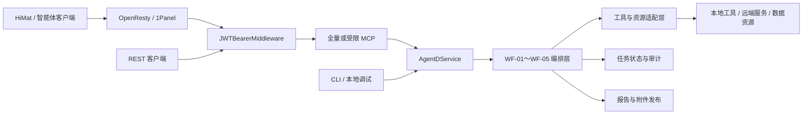
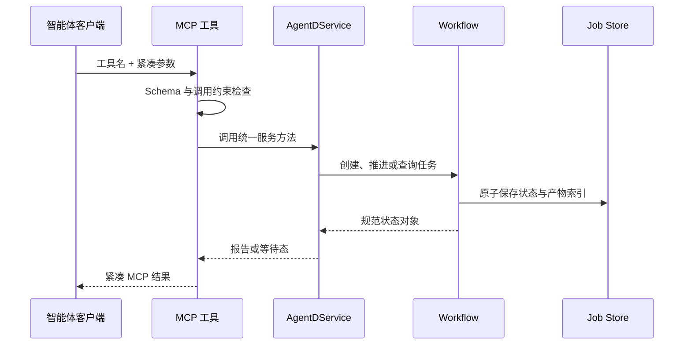
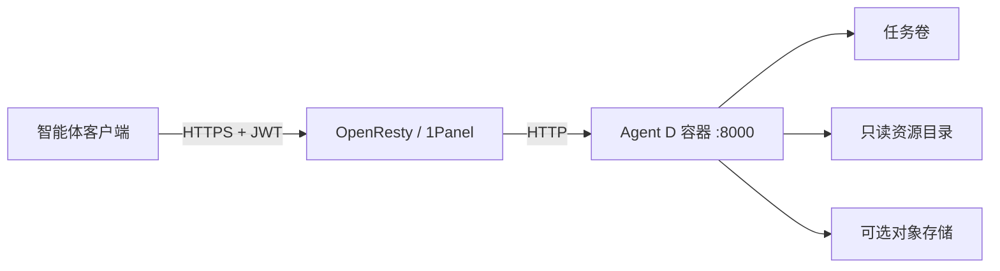

# OligoSmith Agent D 智能体开发交接文档

> 读者：直接参与本仓库开发的智能体工程师
> 文档版本：0.2
> 对应代码版本：1.2.13
> 更新日期：2026-08-30
> 范围：代码架构、工作流编排、MCP 契约、状态持久化、测试与部署

本文只解释如何理解、修改和交付 Agent D。领域规则、参数依据和实验判断不在本文展开；需要修改具体工作流时，以代码、JSON Schema、测试和对应的工作流专题文档为准。

## 1. 项目现状

Agent D 是一个由后端确定性工作流驱动、通过 MCP 交给上层智能体调用的 Python 服务。模型负责理解意图、收集必要字段和选择工具，后端负责状态推进、工具执行、结果校验、持久化和附件交付。

| 项目 | 当前值 |
|---|---|
| Python | 3.11 及以上；容器使用 Python 3.12 |
| 包版本 | 1.2.13 |
| ASGI 入口 | `agentd.mcp_server:app` |
| 主服务门面 | `AgentDService` |
| 主要交付协议 | Streamable HTTP MCP |
| 兼容入口 | REST API、CLI |
| 当前公开工作流 | WF-01～WF-05 |
| 状态存储 | 持久化任务目录；WF-02 另有 SQLite 运行缓存 |
| 部署方式 | Docker Compose + OpenResty / 1Panel |

### 1.1 工作流范围

| 工作流 | 当前工程状态 | 当前公开入口 |
|---|---|---|
| WF-01 | 当前稳定实现，M1～M7 | 有 |
| WF-02 | 当前稳定实现，N01～N32，后台可恢复执行 | 有 |
| WF-03 | 当前稳定实现，独立快照与不可变重试 | 有 |
| WF-04 | 当前稳定实现，六节点执行 | 有 |
| WF-05 | 当前稳定实现，独立快照与不可变重试 | 有 |
| WF-06 | 第二阶段任务已完成，当前暂不继续开发 | 无 |
| WF-07 | 第二阶段任务已完成，当前暂不继续开发 | 无 |

WF-06、WF-07 的状态统一写为“第二阶段任务已完成，当前暂不继续开发”。它们没有挂到现行 MCP、REST、CLI 和能力清单。除非项目重新确定范围，否则不要删除历史实现，也不要重新接入公开路由。

### 1.2 开发时先记住

1. MCP、REST 和 CLI 最终都应调用同一个 `AgentDService`，不能各自实现业务状态机。
2. 上层智能体不执行后端算法，不拼装最终报告，也不猜测缺失状态。
3. 文件正文和大型结果留在服务端，模型只传递不透明引用和紧凑结果。
4. WF-02～WF-05 使用隔离运行时或快照，不能随意导回可变的顶层代码。
5. 工作流状态、执行状态和最终判断是不同字段，不能混用。

## 2. 总体架构



### 2.1 分层职责

| 层 | 负责 | 不负责 |
|---|---|---|
| 智能体层 | 识别意图、补齐输入、调用 MCP、展示后端结果 | 执行规则、计算状态、改写终态结果 |
| MCP 层 | 暴露工具、校验参数、限制工作流作用域、适配 HiMat 输出 | 复制工作流实现 |
| Service 层 | 统一路由、建单、推进、恢复和查询 | 为不同客户端维护不同业务逻辑 |
| Workflow 层 | 执行节点、处理阻塞、重试和版本关系 | 绕过持久化返回临时结论 |
| Tool/Resource 层 | 调用本地工具、远端服务和资源目录 | 决定跨节点流程 |
| Delivery 层 | 生成报告、校验终态卡片、发布附件 | 让模型重新拼装报告 |

### 2.2 设计原则

- 后端是事实来源：任务状态和最终结果只来自持久化对象。
- 接口层保持薄：MCP 和 REST 只做参数、鉴权与协议转换。
- 长任务可恢复：中间状态必须落盘，服务重启后仍可查询或恢复。
- 快照不可变：隔离运行时由字节级完整性测试保护。
- 结果确定性：同一状态对象应生成相同的报告元数据和终态卡片。
- 大数据不上下文：上传正文、完整候选集和原始工具结果不进入模型上下文。

## 3. 仓库结构与代码入口

```text
agentd-primer-probe/
├── src/agentd/                    当前主服务、MCP、REST、工作流和公共工具
├── src/agentd_workflow_snapshots/ 已冻结的工作流运行时快照
├── schemas/                       输入、状态、报告和终态 JSON Schema
├── skills/                        WF-01～WF-05 的模型侧 Skill
├── config/                        资源目录和运行配置
├── deploy/                        Docker、Compose、服务器脚本和发布清单
├── tests/                         单元、契约、集成和快照完整性测试
├── testdata/                      可重复测试资源
└── docs/                          当前文档与历史记录
```

| 文件 | 用途 |
|---|---|
| `src/agentd/mcp_server.py` | 创建全量 MCP、注册工具、组装最终 ASGI 应用 |
| `src/agentd/mcp_scopes.py` | 为 WF-01～WF-05 创建受限 MCP 和工具白名单 |
| `src/agentd/mcp_himat_compat.py` | 把终态结果转换为 HiMat 直接消费的结构 |
| `src/agentd/api.py` | FastAPI 兼容接口；调用同一 Service |
| `src/agentd/service.py` | `AgentDService`，统一服务门面 |
| `src/agentd/input_artifacts.py` | 上传文件、输入引用和服务端解析 |
| `src/agentd/job_store.py` | 通用任务持久化 |
| `src/agentd/workflow_isolation.py` | 隔离运行时加载和命名空间管理 |
| `src/agentd/workflow_delivery.py` | 终态报告与附件卡片 |
| `src/agentd/wf02_runtime.py` | WF-02 后台执行、恢复和并发控制 |
| `src/agentd/wf01_v02*.py` | WF-01 M1～M7 实现 |
| `src/agentd/wf02_v01*.py` | WF-02 主状态机与报告 |
| `src/agentd/workflows/` | 当前工作流编排适配层 |
| `src/agentd_workflow_snapshots/` | WF-02 依赖和 WF-03～WF-05 的冻结运行包 |

推荐阅读顺序：`mcp_server.py` → `service.py` → 对应 Workflow → 对应 Schema → 对应测试。只有修改部署时才继续阅读 `deploy/`。

## 4. 启动与请求链路

### 4.1 应用装配

生产容器使用 `uvicorn agentd.mcp_server:app`。应用从外到内的关键顺序是：

1. `JWTBearerMiddleware` 处理鉴权和调用方身份。
2. `HiMatDirectResultCompatibilityMiddleware` 处理终态 MCP 兼容输出。
3. 全量 `/mcp`、受限 `/mcp/wf01/`～`/mcp/wf05/` 和 FastAPI 兼容路由。
4. MCP 或 REST 调用 `AgentDService`。
5. Service 进入对应运行时并读写任务状态。

`/health` 和 `/ready` 用于探活；其余业务入口默认需要 Bearer JWT。

### 4.2 普通 MCP 请求



### 4.3 上传文件

文件输入必须先经过 `download_himat_file`：

1. 后端下载、校验并保存附件。
2. 工具只返回 `input_artifact_id`。
3. 工作流通过该 ID 在服务端读取正文。
4. 模型上下文中不出现本地路径、完整文件内容或大型解析结果。

不要新增“直接向工作流工具传整份文件正文”的旁路。

### 4.4 终态输出

终态 UI 对象类型为 `primer_design_output`。HTTP 兼容层会把权威对象提升到 JSON-RPC `result`，业务字段只保留 `data` 和 `type`。

- 终态对象由代码生成并通过 Schema 校验。
- MCP `content[0].text` 和 `structuredContent` 必须表达同一个对象。
- 模型不得重新组织附件列表、状态或结论。
- 等待态和终态不能使用同一状态语义。

## 5. 工作流实现

所有当前工作流都遵循同一个工程过程：

```text
输入预检 → 创建任务 → 持久化输入快照 → 推进节点
        → 完成 / 等待交互 / 失败
        → 生成报告 → 校验终态对象 → 发布附件
```

任务开始执行后，不应原地修改已消费的输入。需要改变输入时，创建带父子关系的新任务或新版本。

### 5.1 WF-01

WF-01 是 M1～M7 的批次状态机：

| 阶段 | 工程职责 |
|---|---|
| M1 | 输入预检、任务创建、目标清单确认 |
| M2 | 调用设计引擎并持久化原始执行证据 |
| M3 | 去重、预排序和候选快照 |
| M4 | 调用外部评估并完成最终排序 |
| M5 | 汇总执行结果、缺失证据和任务状态 |
| M6 | 组装 canonical report 并发布附件 |
| M7 | 基于父任务创建不可变新版本 |

主要代码位于 `wf01_v02.py`、`wf01_v02_engine.py` 和 `wf01_v02_m3.py`～`m7.py`。`run-until-blocked` 会持续推进到完成、失败或等待交互，调用方不在模型侧重建阶段判断。

### 5.2 WF-02

WF-02 是 N01～N32 的六阶段长任务，核心工程特征是后台执行和恢复：

- 建单后交给持久化后台执行器。
- 首个同步调用最多等待 235 秒；超时后后台继续运行。
- 查询读取最近一次原子快照，不等待执行锁。
- 服务重启后恢复活动任务。
- 运行缓存使用 SQLite；默认单 worker，避免同一任务并发推进。
- 报告、版本、面板和附件都从同一任务状态生成。

主要代码位于 `wf02_v01.py`、`wf02_runtime.py`、`wf02_v01_report.py`。WF-02 可以调用公共服务和冻结依赖，但不能复制另一工作流的内部状态机。

### 5.3 WF-03

- MCP 只暴露运行、重试和报告。
- 后端调用固定公共服务，不在编排层复制底层算法。
- 重试创建新的不可变子任务。
- 输入、状态目录和报告使用 WF-03 独立命名空间。
- 运行时绑定 `agentd_workflow_snapshots.wf03_v1`。

### 5.4 WF-04

- 使用六节点确定性后端。
- 每个节点分别记录执行状态和判断状态；执行成功不等于判断通过。
- 重试创建不可变子任务，不覆盖原任务。
- 当前编排入口位于 `workflows/wf04_v01.py`，隔离依赖位于 `wf04_v1`。
- 修改节点时必须同步 Schema、报告和回归测试，不能只改显示文案。

### 5.5 WF-05

- 使用独立 `wf05_v1` 快照和六节点后端。
- 任务、重试、报告和附件使用独立命名空间。
- 重试创建不可变子任务。
- 快照文件集合和整体摘要由完整性测试固定。

### 5.6 WF-06 与 WF-07

WF-06、WF-07 的第二阶段任务已经完成，当前暂不继续开发：

1. 状态只写为“第二阶段任务已完成，当前暂不继续开发”。
2. 不把它们加入当前公开 MCP、REST、CLI 或 capabilities。
3. 不删除历史记录和快照；后续是否恢复开发由新的项目范围决定。

## 6. 隔离、状态与契约

### 6.1 快照规则

```text
src/agentd/                         当前可变实现
src/agentd_workflow_snapshots/      已验收的冻结运行时
schemas/                            跨接口的明确契约
```

- 不直接格式化、批量重写或顺手修复快照文件。
- 快照中的空行、导入和静态资源都可能参与哈希校验。
- 允许的差异必须在快照元数据中显式声明 SHA-256。
- 升级旧快照应创建新版本目录，不覆盖旧目录。
- 快照内部使用相对导入，不能导回顶层可变 `agentd`。
- `tests/test_workflow_snapshot_integrity.py` 是最终边界检查。

### 6.2 JSON Schema

`schemas/` 是接口字段的权威来源。修改字段时至少同步：

1. Schema；
2. Python 模型或序列化代码；
3. MCP/REST 输入输出；
4. 对应测试；
5. 受影响的当前实现文档。

### 6.3 持久化与重试

任务状态必须原子写入，并能够回答当前节点、执行状态、交互状态、父任务、报告索引和失败原因。内存对象不能成为唯一事实来源。

重试和版本遵守：

- 原任务不覆盖；
- 新任务记录父任务 ID；
- 输入变化写入新快照；
- 报告可追溯到具体任务和版本；
- 客户端只展示后端返回的关系，不自行推断。

### 6.4 附件

报告正文和大型数据通过附件交付。RustFS 启用时可返回对象存储 URL；未启用时使用签名下载地址。URL、有效期和访问控制由后端生成，模型只转发已校验的附件元数据。

## 7. 本地开发与测试

### 7.1 安装和启动

```powershell
uv venv .venv
uv pip install --python .venv\Scripts\python.exe -e ".[scientific,api,mcp,dev]"

$env:PYTHONPATH = "src"
.venv\Scripts\agentd.exe serve --host 127.0.0.1 --port 8000
```

启动后先检查 `/health`、`/ready` 和 `/v1/capabilities`。`/health` 只代表进程存活；`/ready` 才反映当前配置要求的核心依赖是否就绪。

### 7.2 测试

```powershell
$env:PYTHONPATH = "src"
.venv\Scripts\python.exe -B -m pytest -q -p no:cacheprovider
```

| 修改范围 | 优先测试 |
|---|---|
| MCP 或终态卡片 | `test_mcp_scopes.py`、`test_mcp_himat_compat.py`、`test_workflow_delivery.py` |
| 工作流隔离或快照 | `test_workflow_isolation.py`、`test_workflow_snapshot_integrity.py` |
| WF-01 | `test_wf01_*.py` |
| WF-02 | `test_wf02_*.py` |
| WF-03～WF-05 | 对应 `test_wf03_*.py`、`test_wf04_*.py`、`test_wf05_*.py` |
| 部署包 | `test_deployment_package.py` 和部署脚本验证 |

定向测试用于快速反馈，提交前仍运行完整测试。

## 8. MCP 与智能体边界

| 路径 | 用途 |
|---|---|
| `/mcp` | 全量兼容入口 |
| `/mcp/wf01/` | WF-01 受限工具集 |
| `/mcp/wf02/` | WF-02 受限工具集 |
| `/mcp/wf03/` | WF-03 受限工具集 |
| `/mcp/wf04/` | WF-04 受限工具集 |
| `/mcp/wf05/` | WF-05 受限工具集 |

生产智能体优先连接单工作流入口。工具白名单由 `mcp_scopes.py` 控制，新增工具后必须验证它不会出现在其他工作流的 `tools/list` 中。

模型只负责选择工作流、补齐字段、调用文件工具、推进/查询/回复/重试并展示后端结果。模型不能读取完整附件后自行计算、绕过状态机调用内部节点、猜测任务是否成功或修改终态字段。

新增 MCP 工具的最短闭环：

1. 先在 Service 中提供明确方法。
2. 在全量 MCP 注册薄包装函数。
3. 配置输入和输出 Schema。
4. 加入唯一正确的受限工具集。
5. 增加白名单、契约和终态兼容测试。
6. 更新对应 Skill，不把后端规则写进提示词。
7. 运行完整测试。

## 9. 部署

| 文件 | 作用 |
|---|---|
| `deploy/docker/Dockerfile` | 构建非 root 运行镜像 |
| `deploy/docker-compose.yml` | 服务、卷、只读挂载、资源和健康检查 |
| `deploy/scripts/preflight.sh` | 部署前检查 |
| `deploy/scripts/verify.sh` | 部署后验证 |
| `deploy/release-manifest.json` | 发布包文件和默认参数 |
| `docs/SERVER_INSTALL.md` | 完整安装、升级和回滚步骤 |



容器内监听 8000。生产环境通过宿主机回环地址绑定，再由 OpenResty / 1Panel 提供 HTTPS。不要把容器端口直接公开到外网，也不要把密钥写入 Compose、文档或 Git。

发布检查保持简单：

1. 确认版本号、镜像标签和变更记录一致。
2. 运行完整测试与快照完整性测试。
3. 执行部署前检查。
4. 构建并启动 Compose 服务。
5. 检查 `/health`、`/ready` 和受限 MCP `tools/list`。
6. 用一条最小任务验证建单、查询和终态附件。
7. 保留上一镜像与状态备份，确认后再清理旧资源。

2026-08-30 的线上只读检查显示服务和核心工具就绪，但 `databases_required=false`。这意味着 `/ready` 当前不会把数据库资源作为硬门禁；正式生产是否接受该配置需要项目明确决定。

## 10. 修改代码的标准流程

### 10.1 普通工作流改动

1. 找到 MCP 工具和 Service 方法。
2. 找到实际绑定的工作流或快照版本。
3. 先补失败用例或契约测试。
4. 修改实现，不跨工作流写状态。
5. 同步 Schema、报告和 Skill。
6. 运行定向测试和完整测试。
7. 更新当前实现文档与变更记录。

### 10.2 冻结工作流升级

如果变更会修改冻结快照：

1. 不覆盖旧快照。
2. 创建新版本目录。
3. 更新运行时绑定和版本标识。
4. 更新完整性哈希。
5. 验证旧任务仍可由旧版本读取。
6. 增加迁移或兼容测试。

### 10.3 常见联动

| 改动 | 通常同步 |
|---|---|
| MCP 参数 | Schema、Skill、作用域测试 |
| Service 返回对象 | REST、MCP、终态兼容测试 |
| 工作流节点 | 状态模型、报告、恢复测试 |
| 附件字段 | Delivery、对象存储、UI 卡片测试 |
| 环境变量 | 配置模型、Compose、部署文档 |
| 快照版本 | 绑定、哈希、兼容测试 |
| 公开工作流范围 | capabilities、MCP scopes、README、当前文档 |

## 11. 当前维护重点

- WF-01～WF-05 是当前开发和公开运行范围。
- WF-06、WF-07 是第二阶段已完成任务，当前暂不继续。
- 线上数据库 readiness 硬门禁当前关闭，需要明确生产策略。
- 工作流快照体积较大，但这是隔离和可复现策略的一部分，不要无计划合并。
- 测试中存在依赖库弃用类 warning；不阻塞当前版本，升级依赖时单独处理。

## 12. 继续阅读

- [文档导航](README.md)
- [MCP 服务与鉴权](MCP_SERVER.md)
- [服务器安装、升级与回滚](SERVER_INSTALL.md)
- [工作流隔离架构](WORKFLOW_ISOLATION_ARCHITECTURE.md)
- [WF-01 当前实现](WF01_CURRENT_IMPLEMENTATION.md)
- [WF-02 当前实施台账](WF02_V0.1_IMPLEMENTATION_PLAN.md)
- [WF-03 当前实现](WF03_CURRENT_IMPLEMENTATION.md)
- [WF-05 当前实现](WF05_CURRENT_IMPLEMENTATION.md)
- [统一变更记录](CHANGELOG.md)

本文只维护智能体开发同事需要的主链路。具体字段查 Schema，具体行为查测试，历史变化查 Git 和 `CHANGELOG.md`。
