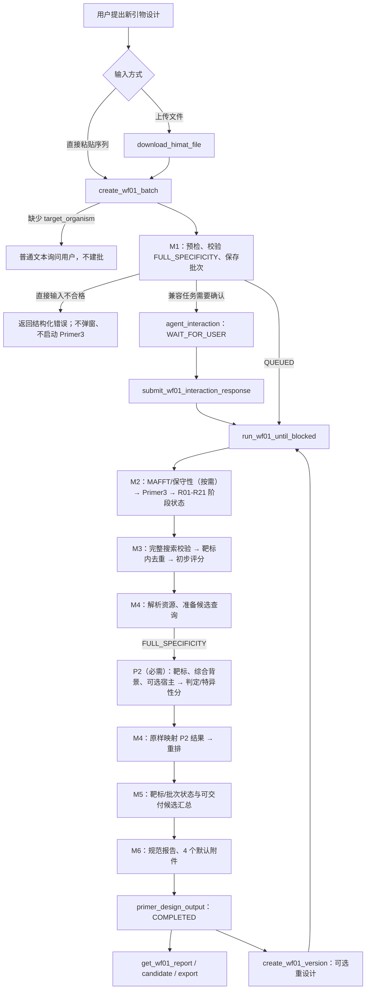

# WF-01 当前实现与运行路线

> 状态：`CURRENT`
> 对照日期：2026-08-19
> 适用代码：当前 `agentd-primer-probe` 工作区
> 持久化协议版本：WF-01 PRD `0.2`

本文是仓库内 **WF-01 唯一的现行人类可读说明**。它描述当前代码实际执行的路线，不再维护 M0～M7 独立计划、旧决策台账或契约化之前的历史设计。

字段级结构以 `schemas/` 中的 JSON Schema 为机器可读依据；若实现发生变化，代码、Schema、测试和本文必须在同一次变更中同步更新。

## 1. 实现入口与权威来源

| 主题 | 当前实现 |
|---|---|
| MCP 工具与资源 | [`src/agentd/mcp_server.py`](../src/agentd/mcp_server.py) |
| 服务编排与自动推进 | [`src/agentd/service.py`](../src/agentd/service.py) |
| M1、持久化、M2～M7 调度 | [`src/agentd/wf01_v02.py`](../src/agentd/wf01_v02.py) |
| M2 Primer3 与规则 | [`src/agentd/wf01_v02_engine.py`](../src/agentd/wf01_v02_engine.py) |
| M3 去重与评分 | [`src/agentd/wf01_v02_m3.py`](../src/agentd/wf01_v02_m3.py) |
| M4 特异性 | [`src/agentd/wf01_v02_m4.py`](../src/agentd/wf01_v02_m4.py) |
| M5 状态汇总 | [`src/agentd/wf01_v02_m5.py`](../src/agentd/wf01_v02_m5.py) |
| M6 报告与导出 | [`src/agentd/wf01_v02_m6.py`](../src/agentd/wf01_v02_m6.py) |
| M7 版本差异 | [`src/agentd/wf01_v02_m7.py`](../src/agentd/wf01_v02_m7.py) |
| 模型安全摘要 | [`src/agentd/wf01_agent_view.py`](../src/agentd/wf01_agent_view.py) |
| 前端消息 | [`src/agentd/ui_messages.py`](../src/agentd/ui_messages.py)、[`src/agentd/interactions.py`](../src/agentd/interactions.py) |

旧接口 `POST /v1/wf01/design` 仍为兼容能力，但不属于当前 PRD v0.2 批次主路线。`POST /v1/tools/primer3/design` 是独立 Primer3 工具，也不等于 WF-01 完整工作流。

## 2. 当前端到端路线

正常新任务由 `create_wf01_batch` 在建批成功后自动调用推进器，依次执行 M2～M6。逐阶段 HTTP 端点主要用于后台控制、测试和故障恢复，不要求对话模型手工串联。

## 3. 输入方式、模板组织与科学路线

这三个概念必须分开：

1. **输入方式**决定使用直接序列还是内部 artifact 引用；两者均不经过输入确认表单。
2. **`sequence_mode`** 决定多条模板如何组成靶标。
3. **`execution_path`** 决定某个靶标是否执行特异性检索。

### 3.1 新任务统一入口

模型面向用户的新设计唯一入口是 `create_wf01_batch`：

- 必填：`target_organism`，以及 `sequence`/`input_artifact_id` 二选一。
- 可选：`host`、`task_name`。
- 缺少 `target_organism` 时不建批，由模型用普通文本询问用户。
- 新任务不暴露 `payload`、`design_input_form` 或 `user_field_updates`。
- 采用 `NO_POPUPS` 模式；预检不通过时直接返回结构化错误，不创建待确认批次。
- 输入合格后自动运行到 M6 或运行时硬边界。

### 3.2 上传文件链路

上传模式固定为两步：

1. 调用 `download_himat_file`，服务端返回 `input_artifact_id` 和文件元数据，不把正文写入模型上下文。
2. 调用 `create_wf01_batch(input_artifact_id=..., target_organism=..., host=...)`。

### 3.3 当前模板组织方式

| `sequence_mode` | 触发方式 | 当前实际行为 |
|---|---|---|
| `alignment_target` | 未提供 `target_manifest` 时的默认值 | 单记录形成一个靶标并跳过 MAFFT；多记录合成一个靶标，M2 先运行 MAFFT，再从保守区调用 Primer3 |
| `independent_targets` | 显式设置，或使用 `target_manifest` 时强制采用 | 每条记录形成独立靶标，每个靶标只有一条模板，不运行 MAFFT；允许靶标级对象与参数 |

因此，当前代码并不是“所有多记录 FASTA 都自动拆成多个独立靶标”。普通多记录输入默认仍是 `alignment_target`；只有 `target_manifest` 路线强制逐记录独立。

### 3.4 当前科学执行路线

| `execution_path` | 判定 | M4 行为 | 最终评分标签 |
|---|---|---|---|
| `DESIGN_ONLY` | 有合格序列但没有靶标对象 | 不初始化 BLAST/数据库；特异性保持 `NOT_EVALUATED` | `DESIGN_SCORE`，只使用热力学与扩增子特征 |
| `FULL_SPECIFICITY` | 提供并解析出靶标对象 | 必须调用 P2：必做靶标命中和综合背景，提供宿主时追加宿主排除；M4 只映射 P2 结果 | `COMPOSITE_SCORE`：有可追溯 MAFFT 证据时使用四维评分，否则明确降为三维 |
| `NOT_EXECUTABLE` | 模板或参数存在阻塞/确认问题 | 不进入 M2 | 无 |

一个 `target_manifest` 批次可以同时包含 `DESIGN_ONLY` 与 `FULL_SPECIFICITY` 靶标，模型摘要将其标记为 `MIXED`。宿主不是启动完整特异性的前提；它只是在已有靶标的完整路线中增加宿主专库排除。

上述 `DESIGN_ONLY` 仅保留给历史批次和底层兼容调用；当前 REST、MCP 和 WF-02 子任务的新建入口均以 `require_full_route=True` 调用服务，不允许新任务静默进入该路线。该门禁在批次持久化前执行，并沿用到清单修订和 M7 新版本。

## 4. M1：预检与批次建立

M1 不调用 Primer3。主要行为如下：

- 接收 `sequence`、`fasta_text`、`template_records`、`target_manifest` 或后端解析后的上传 artifact。
- 模板最小长度为 80 nt；生产设计接受 A/C/G/T。重复记录名、非法碱基、无效参数和本期外能力会形成结构化问题。
- 每靶标固定推荐 Top10，调用方不能改成其他数量。
- 只允许 `default`、`L1`、`L2` 以及一个去重后的用户参数档；没有 L3。
- 生成 `wf01-target-manifest-v1`，靶标状态为 `READY_DESIGN_ONLY`、`READY_FULL`、`NEEDS_CONFIRMATION` 或 `BLOCKED`。
- 可自动执行时批次状态为 `QUEUED`；否则为 `PENDING_CONFIRMATION`。
- 在科学证据区保存 M1 预检快照，正文不会进入模型控制面。

兼容任务可在 M2 之前用 `revise_wf01_target_manifest`/`PATCH /v1/wf01/tasks/{batch_id}/targets` 修改或移除靶标，再重新预检。M2 开始后禁止修改原批次输入；后续变化必须创建 M7 新版本。

## 5. M2～M6 实际阶段

外部 Step 编号与后端 M 编号不是一一对应关系：当前标准路线不包含外部 Step 4；外部 Step 5 对应后端 M4。后端 M5 仅汇总状态，M6 负责 canonical report 与导出。外部流程图和调用说明必须按这个映射展示。

| 阶段 | 进入条件 | 当前行为 | 结束状态/产物 |
|---|---|---|---|
| M2 | `QUEUED` 且没有待处理交互 | `alignment_target` 多模板先完成 MAFFT，计算 Shannon 保守区及候选结合位点证据；单模板直接 Primer3 且保守性为未评估。按去重参数档生成候选，执行 R01～R12 及 R16 等范围/元数据规则 | 批次回到 `EXPLORING`；保存 MAFFT 输入输出、保守性 profile/区域/候选证据、Primer3 证据和搜索单元 |
| M3 | M2 已完成且为 `EXPLORING` | 校验有限 `ExplorationManifest`；不会因已有 10 个候选提前停止；只在同一靶标内按正向/反向/探针序列去重；把已评估的 MAFFT 候选证据纳入版本化预排序 | 生成初步 Top10 和评分追踪，仍等待 P2/M4 |
| M4 | M3 已完成且为 `EXPLORING` | `DESIGN_ONLY` 跳过 P2 并生成二维设计评分；`FULL_SPECIFICITY` 将三模式批次交给必需的 P2，原样消费 P2 判定和特异性分并重排，不定义阈值或命中策略 | 有 MAFFT 证据时形成四维综合分；否则不伪造保守分，按三维重归一化；保存 P2 完整证据 |
| M5 | M4 已完成 | 不调用科学工具；把候选数、搜索完整性、缺失证据和失败范围汇总为靶标及批次状态 | 形成最终科学状态、候选通知和建议；零候选也可进入报告 |
| M6 | M5 已完成 | 从已持久化的 M2～M5 数据组装并校验 canonical report，生成默认附件并发布 | `m6_outcome=COMPLETED`；恢复 M5 科学状态；模型控制动作为 `COMPLETE` |

自动推进遇到以下硬边界会停止：

- 存在 `WAITING_USER`、`USER_SUBMITTED` 或 `RUNNING` 的交互。
- 某阶段已经处于 `RUNNING`，避免非幂等重入。
- M6 已完成。
- 当前持久化状态无法推导下一阶段。

## 6. 当前科学参数、规则与评分

### 6.1 MAFFT 与保守性

- 仅 `alignment_target` 且同一靶标至少有 2 条模板时运行 MAFFT；代表序列目标为 N≥20，2≤N<20 仍可评估，但证据置为低置信度并触发软扣分。
- MAFFT 输出必须与输入记录数、ID 集合和去 gap 后的序列一致，且所有记录等宽；输出顺序按输入恢复。校验失败按工具错误处理，不使用无法追溯的比对。
- Python 在 MAFFT 结果上计算 gap-aware Shannon profile，并映射到首条参考序列坐标。分数锚点为 `H=0 → 1.00`、`H=0.12 → 0.95`、`H=0.50 → 0.90`，gap 通过有效碱基覆盖率降低保守分。
- 保守区按三轮递进选择：`conservation≥0.95 且长度≥150 bp`、`≥0.92 且≥120 bp`、`≥0.90 且≥90 bp`。只使用首个有命中的轮次，按“保守分降序、长度降序、起点升序”选取最多 5 区。后两轮为低置信度。
- 三轮均无区域时，使用首条参考序列全长继续 Primer3，明确标记 `full_length_fallback` 和低置信度，后续仍必须经过 P2。
- 每个候选分别保存正向引物、反向引物和探针结合位点的保守分、最小/平均一致性、精确匹配率、gap/内部插入和变异位点；候选总分只在该三个结合位点上计算。
- 单模板无法声称群体保守性；MAFFT 未实际完成或仅运行开发降级时，R16 和保守性维度均为 `NOT_EVALUATED`，分数为 `null`，不参与综合评分。

IQ-TREE 是可选、非阻塞的后续能力；当前 WF-01 主路线不调用它，也不因缺少它而伪报失败。

### 6.2 参数档

| 档位 | 引物 Tm | 产物长度 | 引物长度 | 普通探针长度 |
|---|---:|---:|---:|---:|
| `default` | 58～62°C | 70～150 bp | 18～28 nt | 22～32 nt |
| `L1` | 58～65°C | 70～180 bp | 18～28 nt | 22～32 nt |
| `L2` | 50～65°C | 70～200 bp | 18～28 nt | 22～32 nt |

用户参数与现有档位完全相同时只执行一次 Primer3；来源标签合并。每个设计单元最多请求 50 个 Primer3 结果，这与最终 Top10 无关。

### 6.3 规则分组

| 规则 | 当前含义 |
|---|---|
| R01 | 两条引物 50～65°C，且 ΔTm≤2°C；任一引物低于 55°C 另记 `R01_SOFT` -5% |
| R02 | 扩增子 70～200 bp；恰为 70 bp 记录边界警戒并降低长度子分 |
| R03 | 每条引物末 5 nt 的 G+C≤2，且不得含连续至少 4 个 G；弱 3′ 风险另记 `R03_SOFT` -2% |
| R04 | 两条引物均为 18～28 nt |
| R05～R08 | 普通探针 5′ 不为 G、位于两引物之间且各留至少 5 bp、相对平均引物 Tm 高 8～10°C、长度 22～32 nt |
| R09 | 任一引物 3′ 自二聚体 ΔG<-6.0 kcal/mol 时排除 |
| R10 | 涉及 3′ 的交叉二聚体 ΔG<-9.0 kcal/mol 时排除 |
| R11 | 发卡风险软警告，-3% |
| R12 | 非 3′ 弱二聚体软警告，-3% |
| R13～R15、R17 | 对本路线不适用的 MGB、多重和内标范围状态 |
| R16 | MAFFT 候选结合位点保守性：已评估且分数≥0.95、高置信度时 `PASS`；放宽轮次、全长回退、N<20 或分数不足时 `WARNING`；无真实 MAFFT 证据时 `NOT_EVALUATED` |
| R18～R21 | 热力学元数据、特异性、证据等级和报告完整性 |

R01～R10 是硬规则：`FAIL` 直接排除，证据缺失则进入硬规则未评估集合。软扣分采用加法合计，再作为百分比一次性作用于基础分；候选不足不会放宽硬阈值。

### 6.4 当前评分

- `FULL_SPECIFICITY` 且保守性已评估：`0.30×保守性 + 0.25×热力学 + 0.25×P2 特异性 + 0.20×扩增子特征`，再应用软规则扣分。
- `FULL_SPECIFICITY` 但保守性未评估：保守性保持 `null` 并退出评分，其余三维按原始权重重归一化，即 `0.357×热力学 + 0.357×特异性 + 0.286×扩增子特征`。
- `DESIGN_ONLY`：只对热力学和扩增子特征的原权重重新归一化，当前有效权重约为 55.5% 与 44.5%；特异性权重为 0，证据状态仍为 `NOT_EVALUATED`。
- 使用第 2/3 轮保守区、全长回退或 N<20 时，已评估的保守性仍进入四维分，同时触发 `LOW_CONFIDENCE_CONSERVATION` -10% 软扣分。
- P2 特异性状态映射：`PASS=100`、`CAUTION=70`、`FAIL=0`；`NOT_EVALUATED` 没有特异性分，M4 只消费该分值。
- 热力学维度由正向引物 Tm、反向引物 Tm、引物 ΔTm、探针相对 Tm 等权组成。
- 扩增子特征由长度和 GC% 等权组成；71～150 bp 的长度子分为 100，70 bp 与 151～200 bp 为 70。
- 当前 M3/M4 策略明确标为 `ACTIVE_FOR_IN_SILICO_RANKING_REQUIRES_EXPERIMENTAL_CALIBRATION`，不能把排序解释为实验性能保证。

## 7. 搜索完整性与最终状态

候选数量与搜索完整性相互独立：已有 Top10 不能证明搜索完成，少于 Top10 也不等于工具失败。

靶标状态模型：

| 状态 | 条件 |
|---|---|
| `SUCCEEDED` | 搜索完整且至少 10 个可交付候选 |
| `PARTIAL` | 搜索完整且有 1～9 个可交付候选 |
| `PARTIAL_INCOMPLETE` | 有可交付候选，但搜索或证据不完整 |
| `FAILED` | 没有可交付候选 |

批次状态模型：全部靶标成功为 `SUCCEEDED`；至少一个靶标可交付但并非全部完整成功为 `PARTIALLY_SUCCEEDED`；全部靶标无可交付候选为 `FAILED`。

当前 M4 会明确保存 `search_complete=false`：

- `DESIGN_ONLY` 的原因为未执行特异性。
- `FULL_SPECIFICITY` 即使技术检索完成，也保留 `DEC_01_DEC_02_POLICY_APPROVAL_PENDING`，表明搜索/特异性判定策略仍按待实验校准口径运行。
- 工具、数据库或证据不完整时记录具体失败范围。

因此，“软件流程完成并生成 M6 报告”不等于“科学搜索状态为 `SUCCEEDED`”。当前有候选的真实批次通常会由 M5 标为 `PARTIAL_INCOMPLETE`/`PARTIALLY_SUCCEEDED`，但仍会生成完整报告，清楚展示缺失证据。

每靶标建议至少 3 个可交付候选。少于 3 个时，当前主路线不会弹出中途对话框，而是写入 `candidate_notice`、报告和最终 `issues`；零候选也生成空结果报告及原因。

## 8. UI、模型上下文与 MCP 工具

### 8.1 两种前端消息

| `type` | 何时出现 | 流程控制 |
|---|---|---|
| `agent_interaction` | 兼容任务的输入问题、可恢复执行错误或历史交互 | `WAIT_FOR_USER`；必须提交完整回复后继续 |
| `primer_design_output` | M6 完成且至少有一个可见附件 | `COMPLETED`；展示报告卡片与附件 |

机器可读契约：

- [`agent-interaction.schema.json`](../schemas/agent-interaction.schema.json)
- [`agent-interaction-response.schema.json`](../schemas/agent-interaction-response.schema.json)
- [`primer-design-output.schema.json`](../schemas/primer-design-output.schema.json)

MCP 同时通过 `oligosmith://contracts/*` 暴露这些 Schema。`outputSchema` 声明并约束
终态分支；HTTP 响应层将权威业务对象直接放入 JSON-RPC `result`，顶层只包含
`data/type`。HiMat 直接使用该结果生成卡片；模型不得生成终态助手文本、
解释、Markdown 或重建 JSON，并立即结束当前轮次。

### 8.2 当前 10 个 WF-01 MCP 工具

| 工具 | 用途 |
|---|---|
| `download_himat_file` | 下载 HiMat 文件并生成内部 artifact 引用 |
| `create_wf01_batch` | 新设计唯一入口；建批后自动运行 |
| `get_wf01_batch` | 获取紧凑任务摘要或重新显示完成卡片 |
| `revise_wf01_target_manifest` | M2 前修改/移除问题靶标 |
| `submit_wf01_interaction_response` | 提交完整用户决策并按需恢复 |
| `run_wf01_until_blocked` | 故障恢复；从持久化阶段继续 |
| `create_wf01_version` | 创建 M7 不可变重设计版本 |
| `get_wf01_report` | 查看紧凑报告或候选分页 |
| `get_wf01_candidate` | 查看一个候选及其规则明细 |
| `get_wf01_export` | 获取默认附件或按需生成 CSV/PDF |

完整批次和 canonical report 可能达到数 MB，不作为普通 MCP 工具响应。模型只接收 `wf01-agent-view-v1` 紧凑控制视图；完整 JSON 通过后台 API、MCP 资源或下载包访问。
最终 `primer_design_output` 继续严格保持 `data/type`；终态控制结构只放在 MCP 外壳 `_meta` 中，
不进入业务对象或 HiMat `block_data`。
内部 `batch_id`、展示用 `batch_code` 和执行状态保存在服务端持久化结果中。后续 MCP 工具兼容内部
UUID 与 `WF01-YYMMDD-HHMM-XXXX` 任务编号，但只有用户在后续轮次明确请求时才允许调用。

## 9. HTTP API

| 类别 | 端点 |
|---|---|
| 输入与 M1 | `POST /v1/wf01/design-input`、`POST /v1/wf01/tasks/preflight`、`POST /v1/wf01/tasks` |
| 批次与清单 | `GET /v1/wf01/tasks/{batch_id}`、`PATCH /v1/wf01/tasks/{batch_id}/targets`、`POST /v1/wf01/tasks/{batch_id}/confirm` |
| 自动推进与交互 | `POST /v1/wf01/tasks/{batch_id}/run-until-blocked`、`GET /v1/wf01/tasks/{batch_id}/interactions`、`POST /v1/wf01/tasks/{batch_id}/interactions/response` |
| 阶段控制 | `POST /v1/wf01/tasks/{batch_id}/run-m2` 至 `POST /v1/wf01/tasks/{batch_id}/run-m6` |
| M7 | `POST /v1/wf01/tasks/{batch_id}/versions` |
| 报告 | `GET /v1/wf01/tasks/{batch_id}/report` |
| 科学产物 | `GET /v1/wf01/tasks/{batch_id}/scientific-artifacts` 及 `/{artifact_id}` |
| 导出 | `GET /v1/wf01/tasks/{batch_id}/exports/{format_name}` 及 `/preview` |
| 附件 | `GET /data/{file_name}` 和兼容报告文件路由 |

逐阶段调用必须遵守持久化状态机，不能跳过前置阶段或在 `RUNNING`/待用户交互时重入。

## 10. 报告、导出和科学证据

M6 的唯一规范数据模型为 `wf01-prd-v0.2-canonical-report-v2`，导出契约为 `wf01-prd-v0.2-export-v5`，Schema 位于 [`wf01-v02-canonical-report.schema.json`](../schemas/wf01-v02-canonical-report.schema.json)。v2 显式保存靶标级 MAFFT/保守区证据和候选级保守性维度。在线筛选只生成只读视图，不裁剪 canonical report 或导出数据。

### 10.1 当前导出

| 格式名 | 生成方式 | 内容 |
|---|---|---|
| `html` | M6 默认 | 候选交付报告 |
| `process_html` | M6 默认 | 科学过程详情 |
| `scientific_data` | M6 默认 | 科学工具数据 ZIP，内含 21 条规则验证报告与辅助表格 |
| `csv` | 用户请求时生成 | canonical report 的表格导出 |
| `pdf` | 用户请求时生成 | 包含 canonical JSON 附件的 PDF |

当前公开输出契约不提供 XLSX，也不把 JSON 作为用户下载附件。代码中即使存在未接线的渲染辅助函数，也不代表该格式已进入当前路线。

默认三个附件（两份 HTML 和一份 ZIP）必须全部持久化并发布，M6 才成功。`rules_html` 不再作为独立附件发布，仅作为 `scientific_data` ZIP 内文件交付。配置 RustFS 时，附件先发布到对象存储再进入报告卡片；未配置时使用本地 `/data/*` 路由，并按 JWT/公开只读配置决定访问边界。

### 10.2 科学证据

| 阶段 | 保存的主要证据 |
|---|---|
| M1 | 原始解析、标准化对象、参数、问题和清单 |
| M2 | MAFFT（按需）输入/输出、Shannon profile、保守区和候选结合位点证据、Primer3 参数与原始结果、硬/软规则明细 |
| M3 | 搜索清单、去重来源、维度分、扣分和排序 |
| M4 | 交给 P2 的查询 FASTA、数据库与版本、P2/BLAST 原始结果及逐候选判定 |
| M5 | 完成/未完成范围、候选状态和批次汇总 |
| M6 | canonical report、完整性校验、导出元数据与哈希 |
| M7 | 来源版本、字段差异、重跑/复用靶标和来源哈希 |

科学 artifact 使用 [`wf01-scientific-artifact.schema.json`](../schemas/wf01-scientific-artifact.schema.json) 和 [`wf01-scientific-artifact-index.schema.json`](../schemas/wf01-scientific-artifact-index.schema.json)。大体量原始证据只在后端和下载包中保存，不直接写入模型上下文。

## 11. M7 版本化重设计

- 来源必须是已经完成 M5 的 WF-01 v0.2 批次。
- 新版本拥有新的 `batch_id` 和递增 `task_version`；来源批次不修改。
- `target_changes` 只能修改允许的 M1 输入字段，必须产生有效差异。
- 修改过的靶标从 M2 重新运行，不复制旧候选或特异性结果。
- 未修改靶标复用原 M2～M5 快照，并记录来源批次、版本、靶标和 SHA-256。
- 新版本创建后为 `QUEUED` 或 `PENDING_CONFIRMATION`；随后通过自动推进器完成新报告。

## 12. 当前边界

- 主路线只设计普通 TaqMan；MGB、简并、多重、通道分配、内标和 ViennaRNA 不进入当前 WF-01 批次科学链。
- MAFFT 是例外：它仍用于当前 `alignment_target` 的多模板兼容路线；`independent_targets` 不使用 MAFFT。
- `DESIGN_ONLY` 可以完成设计与报告，但不得声称已完成特异性。
- P2 是主路线唯一的特异性工具与策略所有者；M4 不复刻其阈值或重新解释命中。
- P2 的资源选择顺序固定：目标优先使用本地版本化条目，缺失时使用任务自身的 SHA-256 不可变输入快照并仅在调用期间物化；综合背景优先使用本地 `cross/nt`，缺失时使用 `BLAST_SEARCH_SERVICE_URL` 配置的远端服务；宿主仍要求本地版本化条目。任何工具错误或无可用回退都只能是 `NOT_EVALUATED`，不能产生虚假 `PASS`。
- 结果仅供科研设计参考，必须经过实验验证后才能用于生产或临床决策。

## 13. 验证与维护

WF-01 当前行为由以下测试组覆盖：

- `tests/test_wf01_v02_preflight.py`
- `tests/test_wf01_v02_mafft.py`
- `tests/test_wf01_v02_m2.py` 至 `tests/test_wf01_v02_m7.py`
- `tests/test_wf01_agent_view.py`
- `tests/test_agent_interactions.py`
- `tests/test_mcp_wf01_input.py`
- `tests/test_mcp_server.py`
- `tests/test_api.py`

维护规则：

1. WF-01 路线变化只更新本文，不再新增 M0～M7 单独文档或决策台账。
2. 字段变化先更新对应 JSON Schema，再更新代码、测试和本文。
3. 模板组织方式、`execution_path`、默认附件或状态机发生变化时，必须同步修改根 README 与 MCP 文档中的摘要。
4. 发布历史只写入 `CHANGELOG.md`；不再创建 `RELEASE_x.y.z.md`。
5. 历史设计通过 Git 查询，不在 `docs/` 根目录保留第二套现行说明。
