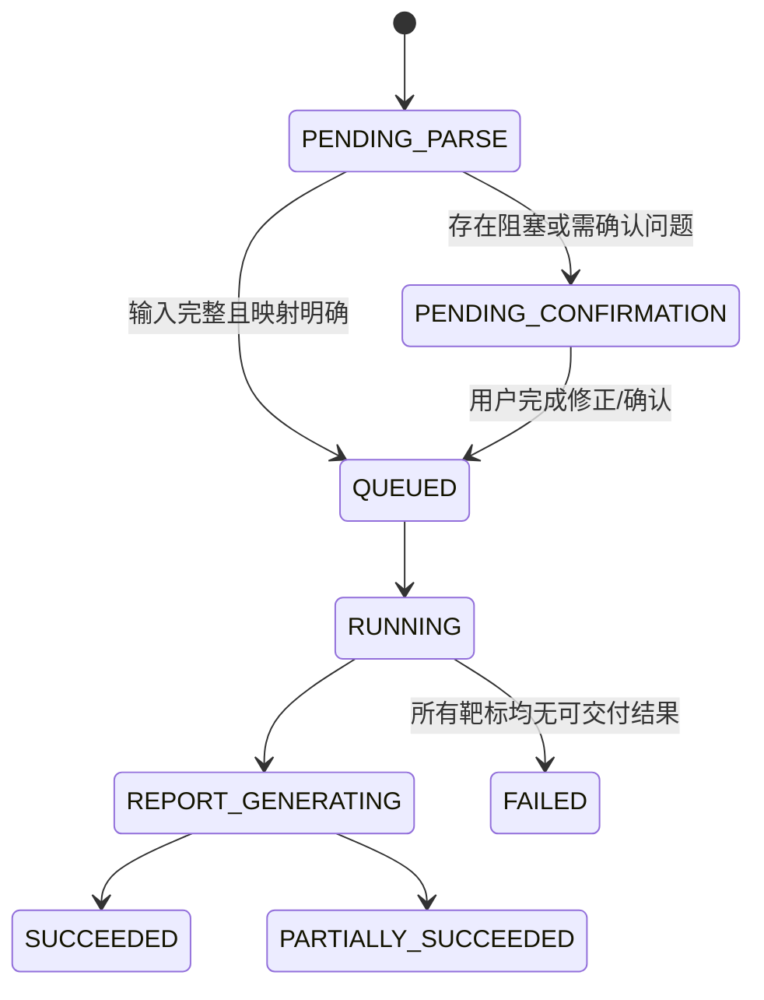
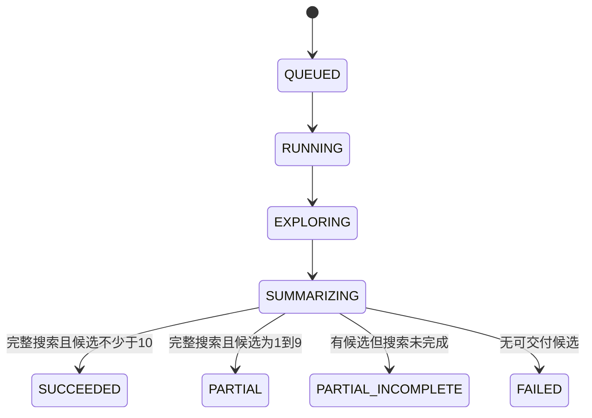

# WF-01 PRD v0.2：Agent 侧设计基线与实施计划

> 需求基线：`引物智能体WF01_PRD_v0.2(1).pdf`  
> 文档版本：v0.1  
> 整理日期：2026-07-30  
> 适用范围：仅本期 WF-01 多模板、多靶标、普通 TaqMan 独立设计的 Agent 后端

## 0. 需求文档优先级

本期设计、开发、测试和验收统一采用以下优先级：

1. `引物智能体WF01_PRD_v0.2(1).pdf` 是本期最高优先级和最终验收依据。
2. 旧版“规则更新.md”只能补充新版 PRD 未规定的科学计算细节。
3. 旧版内容不得扩大新版 PRD 的本期范围；任何冲突均以新版 PRD 为准。
4. 如果新版 PRD 未规定、旧版规则又会影响业务结果或验收结论，则记录为待确认项，不直接继承旧规则。
5. 代码、配置、Schema、测试用例和报告文案都必须能追溯到新版 PRD 条目。

已经确认按新版 PRD 覆盖旧规则的事项包括：

| 事项 | 本期采用的规则 |
|---|---|
| 多条模板 | 每条模板独立创建靶标子任务，不做多序列比对 |
| 模板来源 | 必须由用户提供；名称、taxid、accession 不用于自动获取模板 |
| 最小模板长度 | 80 nt |
| 候选展示 | 每个靶标固定 Top10 |
| 搜索终止 | 获得 Top10 后继续完成预定义搜索空间 |
| 参数档 | 仅用户档、默认档、L1、L2；无 L3 |
| 普通探针长度 | 22–32 nt |
| 扩增子硬范围 | 70–200 bp |
| 保守性 | 不评价、不计分，标记 `NOT_EVALUATED` |
| 评分权重 | 热力学 35.7%、特异性 35.7%、扩增子特征 28.6% |
| MGB/简并/多重/内标 | 本期不做 |
| 扩增子二级结构 | 本期不做，标记 `NOT_EVALUATED` |
| 用户下载格式 | HTML、Excel、PDF；不提供 JSON 下载 |

## 1. 结论

本期 Agent 的核心不是“对多条序列寻找保守区”，而是：

> 一个批次可以包含一条或多条模板序列；每条模板序列创建一个独立靶标子任务，分别完成普通 TaqMan 引物/探针设计、规则检查和三类特异性评估，最后汇总为一个批次报告。

因此，后续设计与实现必须遵循以下六条主线：

1. 多条模板彼此独立，不执行多序列比对，也不把多条 FASTA 记录合成一个靶标。
2. 病原名、基因名、taxid、accession 只用于识别特异性对象，不能代替用户提供模板序列。
3. 每个靶标固定展示 Top10，但获得 10 个候选后不得提前结束预定义搜索空间。
4. 硬规则不可放宽；软规则只警告和扣分；未执行的检查不能伪装成 PASS。
5. 一个靶标失败不能影响其他靶标继续运行和交付。
6. Agent 输出完整、可追溯的结构化报告数据；前端筛选不能改变或裁剪底层完整数据。

## 2. 本期做与不做

### 2.1 本期 Agent 必须负责

- 解析自然语言意图、粘贴序列和多记录 FASTA 的结构化输入。
- 校验模板、参数、对象标识和靶标映射。
- 输出结构化问题清单，支持“待确认”后继续运行。
- 创建批次任务，并按“一条模板 = 一个靶标子任务”拆分。
- 独立调度每个靶标的 Primer3、规则、热力学和特异性检查。
- 执行默认、L1、L2 参数档，并记录每个搜索单元。
- 靶标内去重、评分、排名和固定 Top10。
- 记录批次、靶标、搜索轮次和外部工具的状态与事件。
- 生成前端和导出服务所需的完整规范化报告数据。
- 基于历史任务创建新版本，并记录变更和复用情况。

### 2.2 本期明确不做

- 根据病原名、基因名或 accession 自动下载设计模板。
- 把多条模板当成一个群体做多序列比对、保守区分析或保守性评分。
- 简并引物设计。
- MGB 探针设计和 MGB 修正 Tm。
- 多重 qPCR、荧光通道、跨靶标兼容性。
- 内标或管家基因设计。
- ViennaRNA 或扩增子二级结构评价。
- 已有引物的独立验证、诊断和优化工作流。
- 实验数据回传、参数学习和模型校准。
- SYBR Green、LAMP、RPA、数字 PCR。

已有代码中的 WF-02 至 WF-07、MAFFT、简并、MGB、内标和 ViennaRNA 可以暂时保留，但必须从本期 WF-01 主链路中隔离，不能影响当前任务状态、评分或结果解释。

## 3. Agent 与其他系统的职责边界

| 能力 | Agent 负责 | 前端/平台/导出服务负责 |
|---|---|---|
| 自然语言理解 | 意图、字段、对象、参数和映射解析 | 输入交互和展示 |
| 文件处理 | 接收已上传文件引用并解析 FASTA 内容 | 上传、文件选择、进度展示 |
| 问题确认 | 输出结构化问题、阻塞级别和允许动作 | 呈现确认界面并回传选择 |
| 设计计算 | Primer3、规则、热力学、特异性、评分 | 不参与科学判定 |
| 批次运行 | 子任务调度、隔离失败、进度事件 | 轮询或订阅事件并展示 |
| 报告 | 生成完整规范化报告模型 | 在线视图、HTML/Excel/PDF 渲染 |
| 筛选 | 提供靶标范围和查询参数 | 下拉框、分页和筛选交互 |
| 下载 | 保证数据完整性和导出契约 | 文件生成、存储和下载 |

“取消 JSON”只表示不向最终用户提供 JSON 下载，不表示 Agent 可以取消内部 JSON API。Agent 与前端/导出服务之间仍应使用版本化、可校验的结构化数据契约。

## 4. 建议的领域模型

### 4.1 BatchDesignTask

批次任务是用户一次提交的最外层对象。

关键字段：

- `batch_id`
- `task_version`
- `source_batch_id`、`source_version`
- `intent`
- `status`
- `created_at`、`started_at`、`completed_at`
- `target_total`、`target_completed`、`target_failed`
- `batch_defaults`
- `target_ids`
- `issue_ids`
- `report_id`
- `search_complete`

### 4.2 TargetDesignTask

每条模板序列对应一个独立子任务。

关键字段：

- `target_task_id`
- `batch_id`
- `ordinal`
- `target_code`
- `status`
- `template_id`
- `target_organism`
- `host_objects`
- `related_background_objects`
- `effective_parameters`
- `exploration_manifest`
- `candidate_counts`
- `top10_candidate_ids`
- `search_complete`
- `incomplete_reasons`
- `result_summary`

### 4.3 TemplateSequence

- `template_id`
- `record_name`
- `description`
- `sequence`
- `length_nt`
- `source_type`
- `source_file`
- `source_record_ordinal`
- `checksum`
- `validation_status`
- `validation_issues`
- `preferred_regions`
- `excluded_regions`

### 4.4 SpecificityObject

- `object_id`
- `role`: `TARGET`、`HOST`、`RELATED`、`BACKGROUND`
- `original_input`
- `identifier_type`: `NAME`、`SCIENTIFIC_NAME`、`TAXID`、`ACCESSION`
- `normalized_name`
- `taxid`
- `accessions`
- `resolution_status`
- `database`
- `database_version`
- `scope_query`

### 4.5 ExplorationUnit

搜索空间必须显式建模，不能用“当前已得到 10 个候选”代替。

- `exploration_unit_id`
- `target_task_id`
- `parameter_profile`
- `included_region`
- `excluded_regions`
- `primer3_parameters`
- `status`
- `generated_count`
- `hard_failed_count`
- `specificity_failed_count`
- `qualified_count`
- `started_at`、`completed_at`
- `tool_error`

只有预先生成的 `exploration_manifest` 中所有单元均进入终态，且没有因工具异常跳过的单元，`search_complete` 才能为 `true`。

### 4.6 Candidate

- 三条寡核苷酸序列、方向、长度、坐标、Tm、GC。
- 扩增子序列、坐标、长度。
- Primer3 penalty 和完整参数来源。
- hairpin、homodimer、heterodimer 及 3′ 相关指标。
- R01-R21 规则结果。
- 三类特异性结果及命中证据。
- 参数档和区域来源列表。
- 基础分、每个维度分、逐项扣分、最终分、排名。
- `dedupe_key = SHA256(forward + reverse + probe)`。

### 4.7 Issue

问题确认不能只返回字符串。

- `issue_id`
- `scope`: `BATCH` 或 `TARGET`
- `target_task_id`
- `code`
- `severity`: `BLOCKER`、`CONFIRMATION`、`WARNING`
- `field`
- `message`
- `evidence`
- `allowed_actions`
- `selected_action`
- `status`

### 4.8 RuleResult

统一状态仅允许：

- `PASS`
- `WARNING`
- `FAIL`
- `NOT_EVALUATED`
- `NOT_APPLICABLE`

每条规则至少记录 `code`、`status`、`actual`、`threshold`、`method`、`tool_version`、`message`、`evaluated_at`。

## 5. 状态机

### 5.1 批次状态

### 5.2 靶标状态

外部工具或数据库异常必须产生 `PARTIAL_INCOMPLETE` 或对应检查的 `NOT_EVALUATED`，不能产生“搜索已穷尽”。

## 6. 运行流程

### 6.1 预检阶段

1. 解析自然语言、粘贴内容和文件记录。
2. 保留 FASTA 顺序、记录名、来源文件和原始描述。
3. 为每条记录创建一个靶标草稿，不做序列间比对。
4. 校验模板长度至少 80 nt。
5. 检查非法字符、重复 ID、缺失序列、对象映射冲突和参数越界。
6. 解析 target、host、related/background 的名称、taxid 或 accession。
7. 应用“靶标级配置优先于批次默认”的覆盖规则。
8. 生成 `PreflightResult`：
   - 无问题：允许自动运行。
   - 存在问题：进入 `PENDING_CONFIRMATION`。

只提供病原名、基因名或 accession、没有模板序列时，必须阻塞并要求用户粘贴或上传模板，不能由 Agent 自动补齐模板。

### 6.2 每靶标独立设计阶段

每个靶标严格执行：

1. 输入和对象标识解析。
2. Primer3 候选生成。
3. 硬规则过滤。
4. 软规则警告与扣分。
5. 靶序列命中确认。
6. 宿主排除。
7. 相关种/背景生物 nt 特异性检查。
8. 参数档调整和剩余搜索空间探索。
9. 靶标内去重、评分和排名。
10. 靶标结果汇总。

不同靶标可以并行，但每个靶标的事件、错误、候选和报告必须隔离。

### 6.3 参数档

| 参数 | 默认 | L1 | L2 | 硬边界 |
|---|---:|---:|---:|---:|
| 引物 Tm | 58–62℃ | 58–65℃ | 50–65℃ | 50–65℃ |
| 产物长度 | 70–150 bp | 70–180 bp | 70–200 bp | 70–200 bp |
| 引物长度 | 18–28 nt | 18–28 nt | 18–28 nt | 18–28 nt |
| 普通探针长度 | 22–32 nt | 22–32 nt | 22–32 nt | 22–32 nt |
| 探针 Tm | 平均引物 Tm +8–10℃ | 同左 | 同左 | 同左 |

若用户档、默认档或放宽档的最终参数组合完全相同，只运行一次，并在候选来源中合并档位标签。

本期不存在 L3。

### 6.4 硬规则

| 规则 | 判定 |
|---|---|
| R01 | 引物 Tm 50–65℃，同一对引物 ΔTm ≤2℃ |
| R02 | 扩增子 70–200 bp；超出即排除 |
| R03 | 引物 3′ 末端 5 nt 中 G+C ≤2；连续 G ≥4 排除 |
| R04 | 引物长度 18–28 nt |
| R05 | 探针 5′ 不能为 G |
| R06 | 探针位于两引物之间、不重叠，且与两端至少相距 5 bp |
| R07 | 普通探针 Tm 为平均引物 Tm +8–10℃ |
| R08 | 普通探针长度 22–32 nt |
| R09 | 3′ 自二聚体 ΔG < -6.0 kcal/mol 或强 3′ 自互补即排除 |
| R10 | 涉及 3′ 的交叉二聚体且 ΔG < -9.0 kcal/mol 即排除 |

R05/R06 失败时只能重新生成普通探针，不能切换到 MGB。

### 6.5 软规则与扣分

| 条件 | 结果 |
|---|---|
| 引物 Tm <55℃ | WARNING，最终分减 5% |
| 扩增子长度恰好 70 bp | WARNING，并降低扩增子特征维度 |
| 3′ 末 5 nt 的 GC=0，或出现三个相同连续碱基 | WARNING，最终分减 2% |
| R11 hairpin ΔG < -3 kcal/mol | WARNING，最终分减 3% |
| R12 非 3′ 弱二聚体 ΔG 位于 -9 到 -6 kcal/mol | WARNING，最终分减 3% |

扣分采用加法，并逐项记录来源；不能把多个警告折叠成一个不可解释的总扣分。

### 6.6 特异性评估

每个通过硬规则的候选必须分别产生：

1. `TARGET_HIT`
2. `HOST_EXCLUSION`
3. `RELATED_BACKGROUND_NT`

每项记录：

- 用户原始输入及标准化对象。
- 数据库、数据库版本、范围和阈值。
- 查询序列、命中 accession、identity、coverage、e-value、坐标和判定理由。
- `PASS`、`CAUTION`、`FAIL` 或 `NOT_EVALUATED`。

约束：

- `FAIL` 候选被排除，不能降低特异性阈值以保留。
- 未解析成功的对象不能判为 PASS。
- 工具或数据库异常时标为 `NOT_EVALUATED`，并使该靶标搜索不完整。
- 本期宿主库只明确支持猪、牛、鸡、鸭、鹅、鸽。其他宿主不能声称完成宿主排除。

### 6.7 去重与 Top10

- 只在同一个靶标内去重。
- 正向引物、反向引物和探针三条序列完全相同视为同一候选。
- 保留一个主候选，并合并参数档、搜索区域和 Primer3 运行来源。
- 冲突的规则、热力学或特异性结果保留更严格且已完成的结果。
- 重复出现不能提高评分。
- 每个靶标固定展示 Top10，同时保留所有合格候选和全部被排除候选。

### 6.8 评分

本期不评价保守性，保守性既不计分，也不能以 0 分参与归一化。

| 维度 | 权重 |
|---|---:|
| 热力学 | 35.7% |
| 特异性 | 35.7% |
| 扩增子特征 | 28.6% |

评分顺序：

1. 计算三个维度的原始分。
2. 归一化得到基础分。
3. 加总所有软规则扣分。
4. 生成最终分。
5. 在单个靶标内部排序。

报告必须同时展示各维度得分、权重、基础分、逐项扣分和最终分，并明确写出“保守性未评价且不参与评分”。

## 7. 搜索空间完整性的设计

PRD 要求“得到 Top10 后继续搜索”，但没有定义搜索空间的精确有限边界。实现前必须把它固化为可审计的 `ExplorationManifest`。

建议定义：

- 参数维度：用户档、默认档、L1、L2，去除重复组合。
- 区域维度：完整模板、用户指定目标区域、优选区域和排除区域处理后的确定性搜索单元。
- 每个单元的 Primer3 `PRIMER_NUM_RETURN`、区域切片方法和最大枚举量必须版本化。
- 不允许在候选数达到 10 时提前 `break`。
- 全部单元成功完成才是 `search_complete=true`。
- 工具失败、超时、配额中止和数据库异常都要记录为未完成单元。

产品和业务专家仍需确认“区域如何切片、每个单元枚举多少 Primer3 结果”这两个数值，否则“搜索完成”无法形成可验收定义。

## 8. Agent API 契约建议

### 8.1 预检

`POST /v1/wf01/tasks/preflight`

返回：

- 解析后的批次默认值。
- 靶标草稿列表。
- 标准化的特异性对象。
- 问题列表。
- `can_auto_run`。

### 8.2 创建任务

`POST /v1/wf01/tasks`

要求支持幂等键，避免前端重试产生重复批次。

### 8.3 查询批次

`GET /v1/tasks/{batch_id}`

返回批次状态、靶标状态矩阵、计数和最近事件，不返回全部候选大对象。

### 8.4 查询事件

`GET /v1/tasks/{batch_id}/events?after={event_seq}`

事件使用单调递增的 `event_seq`，建议约每 2 秒聚合一次进度更新。事件至少覆盖：

- 批次状态变化。
- 靶标开始/结束。
- 参数档和搜索单元开始/结束。
- Primer3 候选计数。
- 规则过滤计数。
- 特异性阶段和异常。
- Top10 更新。
- 报告生成。

### 8.5 查询报告

`GET /v1/tasks/{batch_id}/report`

支持 `target_id`、分页和视图范围，但底层 canonical report 必须包含所有靶标的完整数据。

### 8.6 重设计

`POST /v1/tasks/{batch_id}/versions`

输入变更集，创建新版本：

- 未修改靶标可以复用旧结果。
- 修改模板、参数、区域或特异性对象的靶标必须重跑。
- 保存来源版本、字段差异、复用目标和重跑目标。

## 9. 规范化报告模型

报告数据层级：

1. 批次总览。
2. 靶标索引和状态矩阵。
3. 每个靶标的输入、模板和特异性对象。
4. 靶标结论、搜索是否完成、失败/不完整原因。
5. 固定 Top10。
6. 所有合格候选。
7. 所有 Primer3 候选，包括被排除候选及原因。
8. 每个参数档和搜索区域的运行记录。
9. 完整热力学、规则、扣分和评分明细。
10. 三类特异性数据库、版本、阈值和命中详情。
11. `NOT_EVALUATED`、`NOT_APPLICABLE` 和证据声明。
12. 任务版本和重设计差异。

强制规则状态：

- R01-R12：`EVALUATED`。
- R13 MGB：`NOT_APPLICABLE`。
- R14 多重：`NOT_APPLICABLE`。
- R15 内标：`NOT_APPLICABLE`。
- R16 保守性：`NOT_EVALUATED`。
- R17 多重产物长度差：`NOT_APPLICABLE`。
- R18 热力学元数据：`EVALUATED`。
- R19 BLAST/nt：`EVALUATED` 或 `NOT_EVALUATED`。
- R20 证据与免责声明：`EVALUATED`。
- R21 报告完整性：`EVALUATED`。
- 扩增子二级结构：`NOT_EVALUATED`。

所有用户侧 HTML、Excel 和 PDF 导出必须来自同一份 canonical report，禁止三个格式各自拼装业务逻辑。

## 10. 当前实现与 PRD 的主要差距

| 优先级 | 当前实现 | PRD 要求 | 处理建议 |
|---|---|---|---|
| P0 | 多条 `sequences` 会进入 MAFFT/保守区流程，并取第一条为参考 | 每条模板独立创建一个靶标子任务 | 重建批次/靶标模型，WF-01 主链移除 MAFFT |
| P0 | 最小模板长度为 200 nt | 最小 80 nt | 修改预检和运行时校验 |
| P0 | `top_candidates` 可由用户设置，默认 3 | 固定 Top10 | 移除用户可变 Top 数量 |
| P0 | 达到目标数量后存在提前 `break` | 得到 10 后仍完成剩余搜索 | 引入 `ExplorationManifest`，取消候选数驱动终止 |
| P0 | 默认探针 18–30 nt | 普通探针 22–32 nt | 修改配置、Primer3 参数和 R08 |
| P0 | L1/L2 产物下限为 60，L2 上限 180 | L1 70–180，L2 70–200 | 修正参数档和 R02 |
| P0 | 存在 L3/MGB 分支 | 本期没有 L3/MGB | 从本期链路移除，报告标记不适用 |
| P0 | 评分含保守性 30% | 无保守性；35.7/35.7/28.6 | 重写评分明细和测试 |
| P0 | C0 可对输入做模板补齐 | 外部 ID 不能替代模板 | 当前 WF-01 禁止自动获取设计模板 |
| P0 | 缺少靶标内三序列去重与来源合并 | 必须靶标内去重 | 增加稳定 dedupe key 和合并策略 |
| P1 | 结果模型以单个 WorkflowResult 为中心 | 批次 + 多个靶标 + 版本 | 新增批次领域模型和 schema |
| P1 | 任务只有最终 JSON 文件 | 需要多阶段状态、事件和部分成功 | 新增状态存储和事件日志 |
| P1 | 特异性主要是候选后的单一复核流程 | target/host/related-background 三项独立证据 | 重构对象解析和三类检查结果 |
| P1 | 报告偏候选 Markdown 摘要 | 需要全候选、全规则、全命中、全搜索记录 | 建 canonical report schema |
| P1 | 无任务版本和差异复用 | 支持基于旧结果重设计 | 增加版本、diff 和靶标级复用 |

此前基于旧版“规则更新/简并版”形成的 `DOCUMENT_COMPLIANCE_MATRIX.md` 不再作为本期 WF-01 的范围基线。它可以保留为历史参考，但实现优先级必须以本 PRD v0.2 为准。

## 11. 建议实施顺序

### 阶段 A：冻结契约和验收基线

- 固化本期做/不做。
- 定义 Batch、Target、Issue、SpecificityObject、ExplorationUnit、Candidate 和 Report schema。
- 确认搜索空间的有限边界。
- 为 PRD 规则建立不可变的参数和规则表。
- 先写契约测试和黄金样例，不改前端。

完成标准：输入、状态、规则、报告字段和搜索完成定义可被业务、后端、前端共同评审。

### 阶段 B：预检与批次拆分

- 实现多记录 FASTA 解析和一条记录一个靶标。
- 实现对象映射、优先级覆盖和结构化问题清单。
- 禁止 ID 自动补模板。
- 实现 80 nt 下限和重复 ID/非法字符/冲突处理。

完成标准：输入 N 条有效记录稳定创建 N 个独立靶标，顺序和来源不丢失。

### 阶段 C：纯净的单靶标普通 TaqMan 引擎

- 从本期 WF-01 移除 MAFFT、保守性、简并、MGB、ViennaRNA。
- 修正默认/L1/L2 和硬规则。
- 统一热力学元数据。
- 保持单靶标执行函数无批次状态副作用，便于独立重试。

完成标准：一个靶标可确定性运行，R01-R12 及 R13-R21 状态正确。

### 阶段 D：搜索、去重、评分和 Top10

- 建立搜索清单并取消达到数量后的提前停止。
- 实现靶标内去重和来源合并。
- 实现新三维评分、加法扣分和完整解释。
- 输出固定 Top10、所有合格和所有排除候选。

完成标准：Top10 数量与搜索是否完成彼此独立，重复候选不加分。

### 阶段 E：三类特异性和异步容错

- 建立 target/host/related-background 对象解析。
- 接入数据库版本、阈值、命中细节和证据状态。
- 实现限流、超时、重试、断点和靶标级失败隔离。
- 工具异常统一转为 `NOT_EVALUATED`/探索未完成。

完成标准：任一特异性服务异常不会导致其他靶标结果丢失，也不会误报 PASS。

### 阶段 F：事件、报告和重设计

- 实现批次/靶标状态和事件流。
- 建立 canonical report。
- 提供前端和 HTML/Excel/PDF 导出服务的稳定接口。
- 实现任务版本、差异、靶标级复用和重跑。

完成标准：筛选任一靶标不改变完整报告；重设计可追溯到来源版本。

## 12. 最低验收用例

1. 上传含 3 条 FASTA 记录的文件，创建 3 个独立靶标，不调用 MAFFT。
2. 3 个靶标中 1 个输入失败，另外 2 个仍完成并进入批次部分成功。
3. 只提供病原名和 accession、不提供模板时进入待确认，且不自动下载模板。
4. 模板长度 79 nt 被阻塞，80 nt 可进入运行。
5. 默认、L1、L2 参数与 PRD 完全一致，系统中无当前期 L3 分支。
6. 任意 R01-R10 失败的候选被排除，硬阈值不会因候选不足而放宽。
7. 所有规定软规则逐项警告和加法扣分。
8. 得到第 10 个候选后仍完成所有 ExplorationUnit。
9. 同靶标重复三序列候选合并来源且不提高分数；跨靶标不合并。
10. 保守性不进入评分，权重为 35.7%、35.7%、28.6%。
11. 未解析对象和特异性工具异常不会显示 PASS。
12. 一个靶标 BLAST 异常时，其已有候选可交付但状态为探索未完成。
13. Top10、所有合格候选、所有排除候选和搜索日志都进入完整报告。
14. 在线筛选某个靶标后，HTML/Excel/PDF 仍包含全部靶标数据。
15. 修改一个靶标创建新版本时，仅该靶标重跑，其他靶标复用并记录来源。

## 13. 实现前需要确认的五个问题

1. “完整搜索空间”的精确定义：区域切片策略、步长、每个 Primer3 单元的最大返回数。
2. target、host、related/background 三类检查各自的数据库、阈值和 PASS/CAUTION/FAIL 判定表。
3. 不受支持宿主是否允许用户确认后继续，并以 `NOT_EVALUATED` 交付。
4. HTML/Excel/PDF 文件渲染由独立报告服务还是 Agent 仓库中的适配层负责。
5. NCBI/nt 的批次并发、速率限制、最大等待时间和中断恢复策略。

在这五项确认之前可以完成领域模型、预检、批次拆分、纯净单靶标引擎和规则测试；特异性终判与“搜索已完成”的正式验收需要上述定义。
