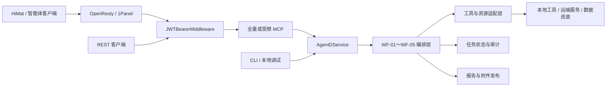
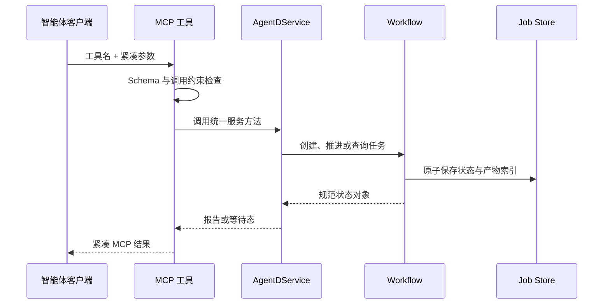
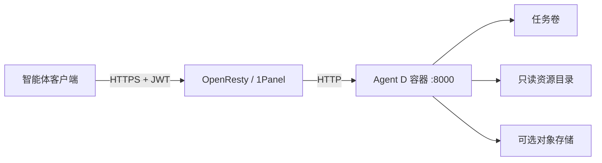

# OligoSmith Agent D 智能体开发交接文档

> 读者：直接参与本仓库开发的智能体工程师
> 文档版本：0.3
> 对应代码版本：1.2.13
> 更新日期：2026-08-30
> 范围：代码架构、工作流编排、MCP 契约、状态持久化、测试与部署

本文只解释如何理解、修改和交付 Agent D。领域规则、参数依据和实验判断不在本文展开；需要修改具体工作流时，以代码、JSON Schema、测试和对应的工作流专题文档为准。

## 1. 项目现状

Agent D 是一个由后端确定性工作流驱动、通过 MCP 交给上层智能体调用的 Python 服务。模型负责理解意图、收集必要字段和选择工具，后端负责状态推进、工具执行、结果校验、持久化和附件交付。

| 项目 | 当前值 |
|---|---|
| Python | 3.11 及以上；容器使用 Python 3.12 |
| 包版本 | 1.2.13 |
| ASGI 入口 | `agentd.mcp_server:app` |
| 主服务门面 | `AgentDService` |
| 主要交付协议 | Streamable HTTP MCP |
| 兼容入口 | REST API、CLI |
| 当前公开工作流 | WF-01～WF-05 |
| 状态存储 | 持久化任务目录；WF-02 另有 SQLite 运行缓存 |
| 部署方式 | Docker Compose + OpenResty / 1Panel |

### 1.1 工作流范围

| 工作流 | 当前工程状态 | 当前公开入口 |
|---|---|---|
| WF-01 | 当前稳定实现，M1～M7 | 有 |
| WF-02 | 当前稳定实现，N01～N32，后台可恢复执行 | 有 |
| WF-03 | 当前稳定实现，独立快照与不可变重试 | 有 |
| WF-04 | 当前稳定实现，六节点执行 | 有 |
| WF-05 | 当前稳定实现，独立快照与不可变重试 | 有 |
| WF-06 | 第二阶段任务已完成，当前暂不继续开发 | 无 |
| WF-07 | 第二阶段任务已完成，当前暂不继续开发 | 无 |

WF-06、WF-07 的状态统一写为“第二阶段任务已完成，当前暂不继续开发”。它们没有挂到现行 MCP、REST、CLI 和能力清单。除非项目重新确定范围，否则不要删除历史实现，也不要重新接入公开路由。

### 1.2 开发时先记住

1. MCP、REST 和 CLI 最终都应调用同一个 `AgentDService`，不能各自实现业务状态机。
2. 上层智能体不执行后端算法，不拼装最终报告，也不猜测缺失状态。
3. 文件正文和大型结果留在服务端，模型只传递不透明引用和紧凑结果。
4. WF-02～WF-05 使用隔离运行时或快照，不能随意导回可变的顶层代码。
5. 工作流状态、执行状态和最终判断是不同字段，不能混用。

## 2. 总体架构



### 2.1 分层职责

| 层 | 负责 | 不负责 |
|---|---|---|
| 智能体层 | 识别意图、补齐输入、调用 MCP、展示后端结果 | 执行规则、计算状态、改写终态结果 |
| MCP 层 | 暴露工具、校验参数、限制工作流作用域、适配 HiMat 输出 | 复制工作流实现 |
| Service 层 | 统一路由、建单、推进、恢复和查询 | 为不同客户端维护不同业务逻辑 |
| Workflow 层 | 执行节点、处理阻塞、重试和版本关系 | 绕过持久化返回临时结论 |
| Tool/Resource 层 | 调用本地工具、远端服务和资源目录 | 决定跨节点流程 |
| Delivery 层 | 生成报告、校验终态卡片、发布附件 | 让模型重新拼装报告 |

### 2.2 设计原则

- 后端是事实来源：任务状态和最终结果只来自持久化对象。
- 接口层保持薄：MCP 和 REST 只做参数、鉴权与协议转换。
- 长任务可恢复：中间状态必须落盘，服务重启后仍可查询或恢复。
- 快照不可变：隔离运行时由字节级完整性测试保护。
- 结果确定性：同一状态对象应生成相同的报告元数据和终态卡片。
- 大数据不上下文：上传正文、完整候选集和原始工具结果不进入模型上下文。

## 3. 仓库结构与代码入口

```text
agentd-primer-probe/
├── src/agentd/                    当前主服务、MCP、REST、工作流和公共工具
├── src/agentd_workflow_snapshots/ 已冻结的工作流运行时快照
├── schemas/                       输入、状态、报告和终态 JSON Schema
├── skills/                        WF-01～WF-05 的模型侧 Skill
├── config/                        资源目录和运行配置
├── deploy/                        Docker、Compose、服务器脚本和发布清单
├── tests/                         单元、契约、集成和快照完整性测试
├── testdata/                      可重复测试资源
└── docs/                          当前文档与历史记录
```

| 文件 | 用途 |
|---|---|
| `src/agentd/mcp_server.py` | 创建全量 MCP、注册工具、组装最终 ASGI 应用 |
| `src/agentd/mcp_scopes.py` | 为 WF-01～WF-05 创建受限 MCP 和工具白名单 |
| `src/agentd/mcp_himat_compat.py` | 把终态结果转换为 HiMat 直接消费的结构 |
| `src/agentd/api.py` | FastAPI 兼容接口；调用同一 Service |
| `src/agentd/service.py` | `AgentDService`，统一服务门面 |
| `src/agentd/input_artifacts.py` | 上传文件、输入引用和服务端解析 |
| `src/agentd/job_store.py` | 通用任务持久化 |
| `src/agentd/workflow_isolation.py` | 隔离运行时加载和命名空间管理 |
| `src/agentd/workflow_delivery.py` | 终态报告与附件卡片 |
| `src/agentd/wf02_runtime.py` | WF-02 后台执行、恢复和并发控制 |
| `src/agentd/wf01_v02*.py` | WF-01 M1～M7 实现 |
| `src/agentd/wf02_v01*.py` | WF-02 主状态机与报告 |
| `src/agentd/workflows/` | 当前工作流编排适配层 |
| `src/agentd_workflow_snapshots/` | WF-02 依赖和 WF-03～WF-05 的冻结运行包 |

推荐阅读顺序：`mcp_server.py` → `service.py` → 对应 Workflow → 对应 Schema → 对应测试。只有修改部署时才继续阅读 `deploy/`。

## 4. 启动与请求链路

### 4.1 应用装配

生产容器使用 `uvicorn agentd.mcp_server:app`。应用从外到内的关键顺序是：

1. `JWTBearerMiddleware` 处理鉴权和调用方身份。
2. `HiMatDirectResultCompatibilityMiddleware` 处理终态 MCP 兼容输出。
3. 全量 `/mcp`、受限 `/mcp/wf01/`～`/mcp/wf05/` 和 FastAPI 兼容路由。
4. MCP 或 REST 调用 `AgentDService`。
5. Service 进入对应运行时并读写任务状态。

`/health` 和 `/ready` 用于探活；其余业务入口默认需要 Bearer JWT。

### 4.2 普通 MCP 请求



### 4.3 上传文件

文件输入必须先经过 `download_himat_file`：

1. 后端下载、校验并保存附件。
2. 工具只返回 `input_artifact_id`。
3. 工作流通过该 ID 在服务端读取正文。
4. 模型上下文中不出现本地路径、完整文件内容或大型解析结果。

不要新增“直接向工作流工具传整份文件正文”的旁路。

### 4.4 终态输出

终态 UI 对象类型为 `primer_design_output`。HTTP 兼容层会把权威对象提升到 JSON-RPC `result`，业务字段只保留 `data` 和 `type`。

- 终态对象由代码生成并通过 Schema 校验。
- MCP `content[0].text` 和 `structuredContent` 必须表达同一个对象。
- 模型不得重新组织附件列表、状态或结论。
- 等待态和终态不能使用同一状态语义。

## 5. 工作流实现

所有当前工作流都遵循同一个工程过程：

```text
输入预检 → 创建任务 → 持久化输入快照 → 推进节点
        → 完成 / 等待交互 / 失败
        → 生成报告 → 校验终态对象 → 发布附件
```

任务开始执行后，不应原地修改已消费的输入。需要改变输入时，创建带父子关系的新任务或新版本。

### 5.1 WF-01

WF-01 是 M1～M7 的批次状态机：

| 阶段 | 工程职责 |
|---|---|
| M1 | 输入预检、任务创建、目标清单确认 |
| M2 | 调用设计引擎并持久化原始执行证据 |
| M3 | 去重、预排序和候选快照 |
| M4 | 调用外部评估并完成最终排序 |
| M5 | 汇总执行结果、缺失证据和任务状态 |
| M6 | 组装 canonical report 并发布附件 |
| M7 | 基于父任务创建不可变新版本 |

主要代码位于 `wf01_v02.py`、`wf01_v02_engine.py` 和 `wf01_v02_m3.py`～`m7.py`。`run-until-blocked` 会持续推进到完成、失败或等待交互，调用方不在模型侧重建阶段判断。

### 5.2 WF-02

WF-02 是 N01～N32 的六阶段长任务，核心工程特征是后台执行和恢复：

- 建单后交给持久化后台执行器。
- 首个同步调用最多等待 235 秒；超时后后台继续运行。
- 查询读取最近一次原子快照，不等待执行锁。
- 服务重启后恢复活动任务。
- 运行缓存使用 SQLite；默认单 worker，避免同一任务并发推进。
- 报告、版本、面板和附件都从同一任务状态生成。

主要代码位于 `wf02_v01.py`、`wf02_runtime.py`、`wf02_v01_report.py`。WF-02 可以调用公共服务和冻结依赖，但不能复制另一工作流的内部状态机。

### 5.3 WF-03

- MCP 只暴露运行、重试和报告。
- 后端调用固定公共服务，不在编排层复制底层算法。
- 重试创建新的不可变子任务。
- 输入、状态目录和报告使用 WF-03 独立命名空间。
- 运行时绑定 `agentd_workflow_snapshots.wf03_v1`。

### 5.4 WF-04

- 使用六节点确定性后端。
- 每个节点分别记录执行状态和判断状态；执行成功不等于判断通过。
- 重试创建不可变子任务，不覆盖原任务。
- 当前编排入口位于 `workflows/wf04_v01.py`，隔离依赖位于 `wf04_v1`。
- 修改节点时必须同步 Schema、报告和回归测试，不能只改显示文案。

### 5.5 WF-05

- 使用独立 `wf05_v1` 快照和六节点后端。
- 任务、重试、报告和附件使用独立命名空间。
- 重试创建不可变子任务。
- 快照文件集合和整体摘要由完整性测试固定。

### 5.6 WF-06 与 WF-07

WF-06、WF-07 的第二阶段任务已经完成，当前暂不继续开发：

1. 状态只写为“第二阶段任务已完成，当前暂不继续开发”。
2. 不把它们加入当前公开 MCP、REST、CLI 或 capabilities。
3. 不删除历史记录和快照；后续是否恢复开发由新的项目范围决定。

## 6. 隔离、状态与契约

### 6.1 快照规则

```text
src/agentd/                         当前可变实现
src/agentd_workflow_snapshots/      已验收的冻结运行时
schemas/                            跨接口的明确契约
```

- 不直接格式化、批量重写或顺手修复快照文件。
- 快照中的空行、导入和静态资源都可能参与哈希校验。
- 允许的差异必须在快照元数据中显式声明 SHA-256。
- 升级旧快照应创建新版本目录，不覆盖旧目录。
- 快照内部使用相对导入，不能导回顶层可变 `agentd`。
- `tests/test_workflow_snapshot_integrity.py` 是最终边界检查。

### 6.2 JSON Schema

`schemas/` 是接口字段的权威来源。修改字段时至少同步：

1. Schema；
2. Python 模型或序列化代码；
3. MCP/REST 输入输出；
4. 对应测试；
5. 受影响的当前实现文档。

### 6.3 持久化与重试

任务状态必须原子写入，并能够回答当前节点、执行状态、交互状态、父任务、报告索引和失败原因。内存对象不能成为唯一事实来源。

重试和版本遵守：

- 原任务不覆盖；
- 新任务记录父任务 ID；
- 输入变化写入新快照；
- 报告可追溯到具体任务和版本；
- 客户端只展示后端返回的关系，不自行推断。

### 6.4 附件

报告正文和大型数据通过附件交付。RustFS 启用时可返回对象存储 URL；未启用时使用签名下载地址。URL、有效期和访问控制由后端生成，模型只转发已校验的附件元数据。

## 7. 本地开发与测试

### 7.1 安装和启动

```powershell
uv venv .venv
uv pip install --python .venv\Scripts\python.exe -e ".[scientific,api,mcp,dev]"

$env:PYTHONPATH = "src"
.venv\Scripts\agentd.exe serve --host 127.0.0.1 --port 8000
```

启动后先检查 `/health`、`/ready` 和 `/v1/capabilities`。`/health` 只代表进程存活；`/ready` 才反映当前配置要求的核心依赖是否就绪。

### 7.2 测试

```powershell
$env:PYTHONPATH = "src"
.venv\Scripts\python.exe -B -m pytest -q -p no:cacheprovider
```

| 修改范围 | 优先测试 |
|---|---|
| MCP 或终态卡片 | `test_mcp_scopes.py`、`test_mcp_himat_compat.py`、`test_workflow_delivery.py` |
| 工作流隔离或快照 | `test_workflow_isolation.py`、`test_workflow_snapshot_integrity.py` |
| WF-01 | `test_wf01_*.py` |
| WF-02 | `test_wf02_*.py` |
| WF-03～WF-05 | 对应 `test_wf03_*.py`、`test_wf04_*.py`、`test_wf05_*.py` |
| 部署包 | `test_deployment_package.py` 和部署脚本验证 |

定向测试用于快速反馈，提交前仍运行完整测试。

## 8. MCP 与智能体边界

| 路径 | 用途 |
|---|---|
| `/mcp` | 全量兼容入口 |
| `/mcp/wf01/` | WF-01 受限工具集 |
| `/mcp/wf02/` | WF-02 受限工具集 |
| `/mcp/wf03/` | WF-03 受限工具集 |
| `/mcp/wf04/` | WF-04 受限工具集 |
| `/mcp/wf05/` | WF-05 受限工具集 |

生产智能体优先连接单工作流入口。工具白名单由 `mcp_scopes.py` 控制，新增工具后必须验证它不会出现在其他工作流的 `tools/list` 中。

模型只负责选择工作流、补齐字段、调用文件工具、推进/查询/回复/重试并展示后端结果。模型不能读取完整附件后自行计算、绕过状态机调用内部节点、猜测任务是否成功或修改终态字段。

新增 MCP 工具的最短闭环：

1. 先在 Service 中提供明确方法。
2. 在全量 MCP 注册薄包装函数。
3. 配置输入和输出 Schema。
4. 加入唯一正确的受限工具集。
5. 增加白名单、契约和终态兼容测试。
6. 更新对应 Skill，不把后端规则写进提示词。
7. 运行完整测试。

## 9. 部署

| 文件 | 作用 |
|---|---|
| `Dockerfile` | 根目录镜像构建入口，构建非 root 运行镜像 |
| `deploy/docker-compose.yml` | 服务、卷、只读挂载、资源和健康检查 |
| `deploy/scripts/install.sh` | 预检、构建、readiness、启动和验收主入口 |
| `deploy/scripts/preflight.sh` | 部署前检查 |
| `deploy/scripts/verify.sh` | 部署后验证 |
| `deploy/release-manifest.json` | 发布包文件和默认参数 |
| `docs/operations/SERVER_INSTALL.md` | 完整安装、升级和回滚步骤 |



容器内监听 8000。生产环境默认绑定宿主机 `127.0.0.1:8020`，再由 OpenResty / 1Panel 提供 HTTPS。不要把容器端口直接公开到外网，也不要把密钥写入 Compose、文档或 Git。

### 9.1 当前线上拓扑与文件位置

以下内容记录的是 2026-08-30 已核对的生产布局。部署脚本和默认配置仍是可移植的；如果服务器目录、域名或外部服务发生变化，应在变更上线的同时更新本节。

```mermaid
flowchart LR
    U[智能体客户端] -->|HTTPS + JWT| P[1Panel / OpenResty]
    P -->|127.0.0.1:8020| A[Compose: agentd-primer-probe / agentd]
    A --> J[Docker 卷 /data/jobs]
    A --> B[/srv/oligosmith-data/blastdb]
    A --> S[/srv/oligosmith-data/sequences]
    A -->|host.docker.internal:8090| X[blast_search_mcp]
    A --> H[HiMat 下载接口]
    A --> R[RustFS wens/data]
    A --> E[NCBI Entrez]
```

| 内容 | 当前线上位置或标识 | 说明 |
|---|---|---|
| 发布包上传目录 | `/opt/oligosmith` | ZIP、外部 SHA-256 文件和解压后的版本目录放在这里 |
| 版本目录 | `/opt/oligosmith/agentd-primer-probe-server-<version>` | 每个正式版本使用独立目录；同版本热修使用带哈希后缀的目录 |
| 生产环境变量 | 当前版本目录下的 `deploy/.env` | 含密钥，权限必须为 `0600`，不能进发布包、Git 或文档 |
| 生产服务配置 | 当前版本目录下的 `deploy/server-config/` | 包括 `production.json` 和生产 `database-catalog.json` |
| BLAST 数据库根目录 | `/srv/oligosmith-data/blastdb` | 独立于代码版本，挂载为只读 |
| 序列资源根目录 | `/srv/oligosmith-data/sequences` | 独立于代码版本，挂载为只读 |
| 任务持久化卷 | `agentd-primer-probe_agentd-jobs` | 容器内 `/data/jobs`；宿主机通常位于 `/var/lib/docker/volumes/agentd-primer-probe_agentd-jobs/_data` |
| 独立 BLAST 服务 | `/opt/blast_search_mcp` | 容器名 `blast_search_mcp`，宿主机端口 `8090` |
| 跨服务器迁移目录 | `/opt/oligosmith-migration-<version>` | 仅在迁移时创建；详见 9.9 |

不要把生成的容器名写死在运维脚本中。Compose 项目名是 `agentd-primer-probe`，服务名是 `agentd`；容器名通常类似 `agentd-primer-probe-agentd-1`，但应始终通过标签定位：

```bash
CURRENT_CID=$(docker ps \
  --filter label=com.docker.compose.project=agentd-primer-probe \
  --filter label=com.docker.compose.service=agentd \
  -q | head -n 1)

test -n "$CURRENT_CID" || {
  echo "未找到当前 Agent D 容器"
  exit 1
}

CURRENT_WORKDIR=$(docker inspect "$CURRENT_CID" \
  --format '{{ index .Config.Labels "com.docker.compose.project.working_dir" }}')

if test -f "$CURRENT_WORKDIR/.env"; then
  CURRENT_DEPLOY_DIR="$CURRENT_WORKDIR"
elif test -f "$CURRENT_WORKDIR/deploy/.env"; then
  CURRENT_DEPLOY_DIR="$CURRENT_WORKDIR/deploy"
else
  echo "找不到当前生产 .env：$CURRENT_WORKDIR"
  exit 1
fi

CURRENT_DIR=$(dirname "$CURRENT_DEPLOY_DIR")
echo "当前容器：$CURRENT_CID"
echo "当前部署目录：$CURRENT_DIR"
```

### 9.2 当前挂载、数据库与外部服务

#### 9.2.1 容器挂载

| 宿主机或 Docker 资源 | 容器内路径 | 模式 |
|---|---|---|
| 当前版本 `deploy/server-config/production.json` | `/config/production.json` | 只读 |
| 当前版本 `deploy/server-config/database-catalog.json` | `/config/database-catalog.json` | 只读 |
| `/srv/oligosmith-data/blastdb` | `/data/blastdb` | 只读 |
| `/srv/oligosmith-data/sequences` | `/data/sequences` | 只读 |
| `agentd-primer-probe_agentd-jobs` | `/data/jobs` | 可写 |

最近一次迁移盘点约为：BLAST 数据库 `3.7G`、序列资源 `476K`、任务卷 `12G`。这些只是容量快照，不是配额；迁移或备份前必须重新执行 `du -sh`。

#### 9.2.2 已确认的数据库资源

| 用途 | 当前宿主机路径或提供方式 | 当前已知版本 |
|---|---|---|
| 猪宿主 BLAST | `/srv/oligosmith-data/blastdb/host/sus_scrofa/current/db` | `Sscrofa11.1_GCF_000003025.6` |
| CSFV 靶标 BLAST 文件 | `/srv/oligosmith-data/blastdb/target/csfv/NC_002657.1/db.*` | `NC_002657.1` |
| 胞内劳森菌靶标 BLAST 文件 | `/srv/oligosmith-data/blastdb/target/lawsonia_intracellularis/GCF_000055945.1_ASM5594v1/db.*` | `GCF_000055945.1_ASM5594v1` |
| 跨物种背景 BLAST | 远程 NCBI BLAST MCP | `http://host.docker.internal:8090` |

`deploy/server-config/database-catalog.json` 随安装包提供的只是模板。最近一次线上盘点的生产 catalog 共登记 19 项资源，并包含真实资源版本号；升级时必须从当前运行目录复制，不能用新包模板覆盖。数据库目录使用版本子目录和 `current` 链接切换；更新数据库时新建版本目录，校验后再切换链接，不要原地覆盖现用文件。

当前本地 `/data/blastdb/cross_species/current/db` 未作为可用跨物种库使用，`cross:default:blast` 由独立的远程 BLAST 服务提供。不要把“远程服务健康”误写成“本地 cross 数据库存在”。

#### 9.2.3 独立 BLAST、HiMat、RustFS 和 NCBI

独立 BLAST 服务的当前约定：

| 项目 | 当前值 |
|---|---|
| 服务源码与 Compose | `/opt/blast_search_mcp` |
| 容器名 | `blast_search_mcp` |
| 宿主机监听 | `0.0.0.0:8090` |
| Agent D 容器访问地址 | `http://host.docker.internal:8090` |
| 健康检查 | `http://127.0.0.1:8090/health` |

Docker 网络 IP（例如 `172.x.x.x`）会变化，配置中不能写死容器 IP。Compose 已通过 `host-gateway` 让 Linux 容器解析 `host.docker.internal`。

当前独立 BLAST 服务发布到了 `0.0.0.0:8090`，应通过云防火墙或宿主机防火墙限制外部访问；Agent D 只需要经宿主机网关访问，不需要把该端口公开给互联网客户端。

其他外部服务的当前约定：

| 服务 | 当前配置 |
|---|---|
| Agent D 公网根地址 | `https://oligosmith.ne.scqcyz.cn` |
| HiMat 文件下载 | `https://himat.ws.scqcyz.cn/api/files/download` |
| RustFS | `RUSTFS_ENABLED=true`；Endpoint 和公开根地址均为 `https://rustfs.ne.scqcyz.cn` |
| RustFS 对象位置 | Bucket `wens`，前缀 `data` |
| NCBI Entrez | P5 在线获取 RefSeq 和同源序列；生产环境设置联系邮箱，API Key 可选 |

RustFS AK/SK、JWT 密钥和 NCBI API Key 只保存在生产 `deploy/.env`。RustFS 账号应仅有 `wens/data/*` 所需的最小读写权限。

#### 9.2.4 数据库门禁与盘点命令

当前线上已知配置为 `AGENTD_REQUIRE_DATABASES=false`，因此 `/ready` 不会因可选或尚未就绪的数据库而整体失败；相应科学结果必须保持 `NOT_EVALUATED`，不能伪造评分。是否改为 `true` 是生产验收决策，不应在普通版本升级时擅自修改。

每次部署前至少运行：

```bash
python3 deploy/scripts/validate_catalog.py \
  --env-file deploy/.env \
  --catalog deploy/server-config/database-catalog.json

docker inspect "$(docker ps \
  --filter label=com.docker.compose.project=agentd-primer-probe \
  --filter label=com.docker.compose.service=agentd \
  -q | head -n 1)" \
  --format '{{ range .Mounts }}{{ println .Source " -> " .Destination }}{{ end }}'

find /srv/oligosmith-data/blastdb -maxdepth 6 -type f \
  \( -name '*.ndb' -o -name '*.nhr' -o -name '*.nin' -o -name '*.nsq' \) \
  | sort

curl -fsS http://127.0.0.1:8090/health
```

catalog 验证结果中的 `skipped_optional` 表示可选项未检查或未提供，不等于全部数据库都已安装。应结合具体工作流所需资源和最终报告中的评估状态判断。

### 9.3 服务器准备

推荐环境：Linux x86_64、Docker Engine 24+、Docker Compose v2、`curl`，至少 4 核 CPU、8 GB 内存和 10 GB 应用盘。数据库与任务数据另行规划磁盘。

部署代码可以来自 Git 仓库或经过 SHA-256 校验的服务器源码包。进入项目根目录后先确保脚本可执行：

```bash
chmod +x deploy/scripts/*.sh
```

### 9.4 配置 `deploy/.env`

```bash
cp deploy/.env.example deploy/.env
chmod 600 deploy/.env
vi deploy/.env
```

首次部署至少核对：

| 配置 | 要求 |
|---|---|
| `JWT_SECRET` | 替换为足够长的随机值，不能保留模板内容 |
| `AGENTD_IMAGE_TAG` | 与本次发布版本一致 |
| `AGENTD_BIND_ADDRESS` | 默认保持 `127.0.0.1` |
| `AGENTD_PORT` | 默认 `8020` |
| `AGENTD_BLASTDB_DIR` | 当前线上为 `/srv/oligosmith-data/blastdb` |
| `AGENTD_SEQUENCE_DATA_DIR` | 当前线上为 `/srv/oligosmith-data/sequences` |
| `AGENTD_REQUIRE_DATABASES` | 理想生产门禁为 `true`；当前线上为 `false`，普通升级必须原样继承，含义见 9.2.4 |
| `MCP_PUBLIC_BASE_URL` | 当前线上为 `https://oligosmith.ne.scqcyz.cn` |
| `MCP_ALLOWED_HOSTS` | 公网域名及必要的本地探活地址 |
| `MCP_ALLOWED_ORIGINS` | 允许访问的 HTTPS 来源 |
| `BLAST_SEARCH_SERVICE_URL` | 当前线上为 `http://host.docker.internal:8090` |
| `HIMAT_FILE_DOWNLOAD_BASE_URL` | 当前线上为 `https://himat.ws.scqcyz.cn/api/files/download` |
| `RUSTFS_*` | 当前线上已启用，Bucket 为 `wens`、前缀为 `data`；只使用最小权限账号 |

资源目录映射和版本信息维护在 `deploy/server-config/database-catalog.json`。不要直接修改 `docker-compose.yml` 写死服务器路径或密钥。

### 9.5 日常版本更新

线上服务已经完成首次部署。本节只说明日常如何把 Agent D 更新到新版本；首次安装、服务器迁移和数据库建设不属于同事的日常更新操作。

更新时遵守五条规则：

1. 把新 ZIP 和同名 `.zip.sha256` 上传到 `/opt/oligosmith`。
2. 每次发布都使用新的版本号；不要用不同内容覆盖已经上线的同版本包。
3. 下面整段命令只需要修改第一处 `VERSION`。
4. 不需要备份 BLAST 数据库、序列目录或任务卷；它们位于版本目录之外。新版本会自动继承当前生产 `.env` 和 `server-config`。
5. 禁止执行 `docker compose down -v`，它会删除任务卷。

#### 9.5.1 执行更新

下面以 `1.2.14` 为示例。可以整段复制到服务器终端执行；如果安装包已经在 1Panel 中解压，脚本会直接验证现有目录，不会重复解压。

```bash
set -Eeuo pipefail

# 每次更新只修改这一行
VERSION=1.2.14

BASE_DIR=/opt/oligosmith
ZIP="$BASE_DIR/agentd-primer-probe-server-$VERSION.zip"
SHA_FILE="$ZIP.sha256"
NEW_DIR="$BASE_DIR/agentd-primer-probe-server-$VERSION"

cd "$BASE_DIR"
sha256sum -c "$SHA_FILE"

# 已经在 1Panel 解压时会跳过此步
if test ! -d "$NEW_DIR"; then
  unzip -q "$ZIP"
fi

cd "$NEW_DIR"
sha256sum -c PACKAGE-MANIFEST.sha256
chmod +x deploy/scripts/*.sh

# 定位当前线上版本
CURRENT_CID=$(docker ps \
  --filter label=com.docker.compose.project=agentd-primer-probe \
  --filter label=com.docker.compose.service=agentd \
  -q | head -n 1)

test -n "$CURRENT_CID" || {
  echo "未找到当前 Agent D 容器"
  exit 1
}

CURRENT_DEPLOY_DIR=$(docker inspect "$CURRENT_CID" \
  --format '{{ index .Config.Labels "com.docker.compose.project.working_dir" }}')

test -f "$CURRENT_DEPLOY_DIR/.env" || {
  echo "找不到当前生产 .env：$CURRENT_DEPLOY_DIR"
  exit 1
}

CURRENT_DIR=$(dirname "$CURRENT_DEPLOY_DIR")

test "$CURRENT_DIR" != "$NEW_DIR" || {
  echo "目标版本已经上线；请使用新的版本号重新打包"
  exit 1
}

echo "当前版本目录：$CURRENT_DIR"
echo "新版本目录：$NEW_DIR"

# 继承生产配置
cp -a "$CURRENT_DEPLOY_DIR/.env" "$NEW_DIR/deploy/.env"
cp -a "$CURRENT_DEPLOY_DIR/server-config/." \
  "$NEW_DIR/deploy/server-config/"

chmod 600 "$NEW_DIR/deploy/.env"

grep -q '^AGENTD_IMAGE_TAG=' "$NEW_DIR/deploy/.env" || {
  echo "生产 .env 缺少 AGENTD_IMAGE_TAG"
  exit 1
}

sed -i "s/^AGENTD_IMAGE_TAG=.*/AGENTD_IMAGE_TAG=$VERSION/" \
  "$NEW_DIR/deploy/.env"

# 安装脚本会完成预检、构建、切换和验收
bash deploy/scripts/install.sh

# 确认实际运行版本
NEW_CID=$(docker ps \
  --filter label=com.docker.compose.project=agentd-primer-probe \
  --filter label=com.docker.compose.service=agentd \
  -q | head -n 1)

RUNNING_VERSION=$(docker exec "$NEW_CID" \
  python -c 'import agentd; print(agentd.__version__)')

test "$RUNNING_VERSION" = "$VERSION" || {
  echo "版本不一致：期望 $VERSION，实际 $RUNNING_VERSION"
  exit 1
}

docker compose \
  --env-file deploy/.env \
  -f deploy/docker-compose.yml \
  ps

echo "Agent D $VERSION 更新完成"
```

`deploy/scripts/install.sh` 已经包含预检、镜像构建、容器 readiness、服务切换和 HTTP 验收，不需要再分开执行 `--build-only` 和 `--no-build`。

如果发布说明明确新增了环境变量，先把新键补到复制后的 `deploy/.env` 再执行安装；不能用 `.env.example` 覆盖生产配置，也不能用安装包模板覆盖生产 `database-catalog.json`。

#### 9.5.2 更新后的确认与清理

命令全部通过后，再从上层智能体运行一条本次受影响工作流的最小真实任务，确认：

- 状态可以正常推进到终态；
- 报告、附件预览/下载和 RustFS 地址正常；
- 最终输出仍符合当前 `{data,type}` 协议；
- 特异性或数据库未执行时，报告保持 `NOT_EVALUATED`，不会伪造评分。

出现问题时，在新版本目录查看日志：

```bash
docker compose \
  --env-file deploy/.env \
  -f deploy/docker-compose.yml \
  logs --tail 150 agentd
```

确认新版本和真实任务都正常后，可以删除不用的旧版本目录、旧 ZIP 和旧 SHA-256 文件。不要删除：

- `/srv/oligosmith-data/blastdb`；
- `/srv/oligosmith-data/sequences`；
- `agentd-primer-probe_agentd-jobs` 卷；
- `/opt/blast_search_mcp`；
- 当前运行版本的 `deploy/.env` 和 `deploy/server-config/`；
- RustFS 上的 `wens/data/*` 对象。

## 10. 修改代码的标准流程

### 10.1 普通工作流改动

1. 找到 MCP 工具和 Service 方法。
2. 找到实际绑定的工作流或快照版本。
3. 先补失败用例或契约测试。
4. 修改实现，不跨工作流写状态。
5. 同步 Schema、报告和 Skill。
6. 运行定向测试和完整测试。
7. 更新当前实现文档与变更记录。

### 10.2 冻结工作流升级

如果变更会修改冻结快照：

1. 不覆盖旧快照。
2. 创建新版本目录。
3. 更新运行时绑定和版本标识。
4. 更新完整性哈希。
5. 验证旧任务仍可由旧版本读取。
6. 增加迁移或兼容测试。

### 10.3 常见联动

| 改动 | 通常同步 |
|---|---|
| MCP 参数 | Schema、Skill、作用域测试 |
| Service 返回对象 | REST、MCP、终态兼容测试 |
| 工作流节点 | 状态模型、报告、恢复测试 |
| 附件字段 | Delivery、对象存储、UI 卡片测试 |
| 环境变量 | 配置模型、Compose、部署文档 |
| 快照版本 | 绑定、哈希、兼容测试 |
| 公开工作流范围 | capabilities、MCP scopes、README、当前文档 |

## 11. 当前维护重点

- WF-01～WF-05 是当前开发和公开运行范围。
- WF-06、WF-07 是第二阶段已完成任务，当前暂不继续。
- 线上数据库 readiness 硬门禁当前关闭，需要明确生产策略。
- 工作流快照体积较大，但这是隔离和可复现策略的一部分，不要无计划合并。
- 测试中存在依赖库弃用类 warning；不阻塞当前版本，升级依赖时单独处理。

## 12. 继续阅读

- [文档导航](../README.md)
- [MCP 服务与鉴权](../operations/MCP_SERVER.md)
- [服务器安装、升级与回滚](../operations/SERVER_INSTALL.md)
- [工作流隔离架构](WORKFLOW_ISOLATION_ARCHITECTURE.md)
- [WF-01 当前实现](../workflows/wf01/WF01_CURRENT_IMPLEMENTATION.md)
- [WF-02 当前实施台账](../workflows/wf02/WF02_V0.1_IMPLEMENTATION_PLAN.md)
- [WF-03 当前实现](../workflows/wf03/WF03_CURRENT_IMPLEMENTATION.md)
- [WF-05 当前实现](../workflows/wf05/WF05_CURRENT_IMPLEMENTATION.md)
- [统一变更记录](../history/CHANGELOG.md)

本文只维护智能体开发同事需要的主链路。具体字段查 Schema，具体行为查测试，历史变化查 Git 和 `CHANGELOG.md`。
